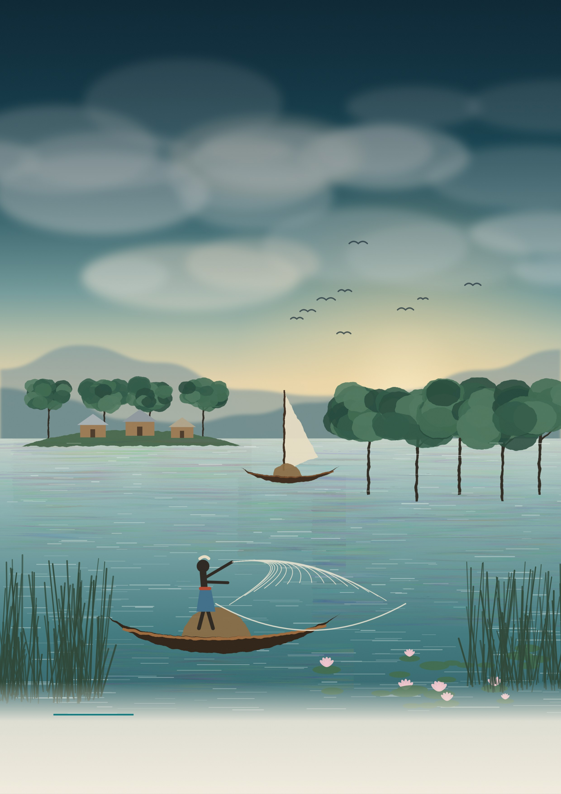

::: {.cover .html-only}

River · Commons · Scientific Reasoning

Making Commons Dynamic

A Deep Study Companion for the Ephemeral Commons of Bangladesh Workshop

From first principles to reconstructing the authors' reasoning, testing the evidence, and building bridges to haor and hilsa research: an illustrated textbook (English edition)

<b>Working edition 1.0 · November 2026</b> · Source-grounded analysis of the ten assigned readings; each chapter states what was fully analysed and what is only mapped. The cover is a conceptual scene, not a map or photograph of any particular place. A Bengali edition with the same structure is available.

:::

::: docx-only
{width=100%}

**Making Commons Dynamic** · *A Deep Study Companion for the Ephemeral Commons of Bangladesh Workshop* (English edition)
:::

# Editorial note and source disclosure [What was read, and how]{.en}

This book prepares a reader for a workshop, but its aim is wider than the workshop. We want the reader to understand the **architecture of thinking** in the ten assigned works. For each one we ask four things:

- what puzzle the authors saw;
- which concepts they used to capture it;
- what evidence they gathered;
- where the path from evidence to claim stands on firm ground, and where it leaps.

### Where the sources came from: an honest account

The brief asked for the ten original PDFs to be read from a Google Drive folder. **That folder was not visible to the Drive account connected to this work** (file IDs returned "not found"; direct links required a login). The **published version** of each work was therefore read from the publisher or an institutional repository, and the coverage ledger in the appendix records which copy was read. Two cautions follow:

1. Page numbers follow the printed journal pages. If the PDF in your Drive is paginated differently, match by section heading.
2. Two books, **Ostrom (1990)** and **Nayak (ed.) (2021)**, were not openly available. Their chapter lists were verified (library catalogue and publisher's page), but the chapters themselves were not analysed in this edition. The book labels those two chapters "mapped chapters" and makes no chapter-specific claims about them.

The full PDF of the FAO book **Berkes & Franz (2025)** was available; only Chapter 5 (Commons) and a few relevant boxes were read in depth, and the remaining chapters are mapped from the contents page. The "Flood Survival Guide" PDF supplied as a visual reference could not be opened from this work's network, so **its design was not seen**. The design of this book comes entirely from the written design brief.

::: {.box .caution}
Workshop schedule
No speaker list or session schedule was available. This book therefore does not say which authors will attend or in what order sessions will run. The reading order follows a teaching logic (see "How to use this book"). The "questions for the author" sections are written so they can be used once a speaker is confirmed.
:::

### The grammar of evidence labels

Throughout the book, claims carry one of four labels:

| Label | Meaning | Typical phrasing |
|---|---|---|
| D documented | The authors state it explicitly | "The Methods section says…" |
| I inference | A reasoned reconstruction from the text's structure and evidence | "This comparison appears intended to separate…" |
| H hypothetical | An alternative design we are imagining | "A different design could test…" |
| U unknown | The published text does not tell us | "Why, the authors do not report…" |

In figures, a **solid arrow** means a relation described in the source, a **dashed arrow** a hypothesised relation or a leap in reasoning, and a **dotted arrow** an uncertain possibility. Where a figure uses invented examples, the caption says so.

# How to use this book [Reading route and order]{.en}

![[Figure 0.1]{.fnum} The reading route. Skip a step and the authors' reasoning shrinks into a summary; the thinking is lost.](../figures_en/fig_0_1_start_here.svg){width=100%}

The book has six parts.

- **Part 1** teaches common-pool resources, rights, institutions, collective action, the SES framework and "commons as process" from first principles.
- **Part 2** teaches the chain of reasoning from research question to claim, so that the authors' designs can be judged in later chapters.
- **Part 3** gives each assigned reading its own chapter.
- **Part 4** reads the texts against each other for agreement and disagreement.
- **Part 5** builds bridges to your hilsa, haor, microbiology and physiology research, with the evidence level of each link marked.
- **Part 6** holds the workshop sheets, glossary and references.

**If time is short:** read Chapters 1, 5 and 6. Then read the "reasoning reconstruction" and "critique" sections of each Part 3 chapter, and finish with the revision sheets in Part 6.

**To go deep:** write your own answer to each chapter's "scientist's decision lab" before looking at the guided answer. Guided answers are kept separately, at the end of the book.

::: {.box .recap}
Reading order and its logic
W01 Ostrom 1990 (mapped) → W02 Ostrom et al. 1999 → W03 Ostrom 2007 → W04 Ostrom 2009 → W05 Agrawal et al. 2023 → W06 Nayak & Berkes 2011 → W07 Galappaththi & Nayak 2017 → W09 Nayak & Berkes 2022 → W08 Nayak 2021 (mapped) → W10 Berkes & Franz 2025.

The order follows the argument's development:

- first, the case that commons *can* work (W01–W02);
- then a framework for diagnosing many variables (W03–W04);
- then the field's own critique that it has focused on stability (W05 §2.2.2);
- then a theory of change (W06 → W07 → W09 → W08);
- finally, everything brought to small-scale fisheries policy (W10).

This is a **teaching** order, not evidence of intellectual influence between the texts. Where one text directly cites another, Chapter 17 verifies and shows it.
:::

::: {.divider}
::: inner

PART I

# Foundations: the conceptual world of the commons {.part}

Aim: after five chapters you will be able to tell apart, and then connect, resource attributes, property-rights regimes, institutions, collective action and processes of change. Prerequisites: none.
:::
:::

::: {.chapter-opener}

Part 1 · Chapter 1 · Concept explorer

# 1 · What is a common-pool resource? [Resource attributes versus property rights]{.en}

::: chapter-meta

<b>Question for this chapter:</b> when we call the fish of a haor a "commons", are we describing the resource or people's rights?

<b>Prerequisites:</b> none. Keep a picture of a beel or river in mind.

<b>Used in:</b> W02 (p.278–279), W05 (§2.1), W06 (p.132–133), W09 (Box 1), W10 (§5.2)

<b>Time:</b> 40 minutes reading + 10 minutes writing

:::
:::

Picture a haor in the monsoon. Fishers from ten surrounding villages cast their nets in the same water. If one of them catches more today, there is less for the others tomorrow. Keeping anyone out is also hard: you cannot fence such a large expanse, guarding costs money, and boats move at night. When these two attributes occur together, institutional scholars call the resource a **common-pool resource** (CPR).

Ostrom and colleagues wrote the definition with care. A CPR is a resource system in which (1) excluding beneficiaries through physical or institutional means is especially costly, and (2) exploitation by one user reduces availability for others D (Ostrom et al. 1999, p.278). Notice that in the sentence just before, they insist that concepts about the "resource system" be separated from concepts about "property rights", and that the term CPR refers to resource systems "regardless of the property rights involved". That separation is the first lesson of this book.

::: {.box .concept}
Core concept
**CPR names an attribute of a resource; common (group) property names a rights regime; open access means the absence of effective rights.** Treat the three as synonyms and the whole literature will be misread. Ostrom et al. (1999, Table 1) list four regimes: open access, group property, individual property and government property.
:::

### Why the concept was needed

In 1968 Garrett Hardin argued that on a pasture open to all, each herder would add one more animal for private gain, and the collective result would be ruin. His proposed remedy was "either socialism or the privatism of free enterprise" (quoted in W02, p.278). The trouble is that many applied his story to every "commons". W02 notes that this "starkness" was used to justify central government control D. Separating CPR from property regime changes the question. Instead of asking "Will the resource be destroyed?", we ask: **under which rules and rights regimes, and in what circumstances,** do users build sustainable use?

Fisheries economists had modelled the problem more than a decade before Hardin. W10 (§5.2, p.62) recalls that Gordon (1954) and Scott (1955) showed how, without property rights, surplus labour and capital flow into a fishery, rents dissipate and stocks decline. The individual-quota (ITQ) solution later grew from this line of work. The argument "no rights, therefore ruin" thus has two lineages: Hardin's metaphor and fisheries-economics models.

![[Figure 1.1]{.fnum} Types of goods (top) and property-rights regimes (bottom) are two different layers. The top grid shows attributes of the resource; the bottom row shows rules made by people. The same haor fishery can sit under four different regimes. Conceptual sources: Ostrom et al. (1999) Table 1; Agrawal et al. (2023) §2.1. Original redraw, not a copy of a source figure.](../figures_en/fig_1_1_goods_regimes.svg){width=100%}

::: fig-read
First decide which cell of the top grid your resource falls into (attributes). Then, in the bottom row, ask who can exclude whom at this moment and who makes the rules (rights). The two answers can differ.
:::

### Mechanism: how the two attributes create a dilemma

When exclusion is hard, anyone can enter; when use is subtractive, each person's harvest raises costs for everyone else. W02 (p.279) therefore describes two forms of free-riding: (a) overuse without regard for the harm to others, and (b) failure to contribute to maintaining or improving the resource D. In a haor, the first is catching egg-bearing fish; the second is not giving labour to re-dig a beel's connecting channel.

W02 lists further attributes that change how hard governance is: size and carrying capacity, measurability, the spatial and temporal availability of flows, storage, whether the resource moves (water, wildlife, most fish) or stays put (trees), and the rate of regeneration D (p.279). The authors note that counting trees in a forest is relatively easy, while assessing migratory fish stocks and irrigation water in a system without storage is far harder. For a hilsa researcher this is directly relevant: hilsa is a textbook example of a mobile, seasonal, hard-to-measure resource.

::: {.box .method}
Operationalising
A field question for excludability: "How much cost and risk does it take to stop an outside boat entering your jalmohal?" Measuring subtractability needs biological data: does catch per unit effort (CPUE) fall as fishing pressure rises? The first is social-institutional data, the second ecological. This is where interdisciplinary work becomes necessary.
:::

### The attributes are not fixed

W05 adds an important subtlety. Excludability and subtractability are "characteristics of goods", but institutions and technologies determine how easy exclusion is. The invention of barbed wire, for example, made the privatisation of land in the American West possible D (Agrawal et al. 2023, §2.1). W02 likewise says that technology helps identify and monitor resources but "is not a substitute for decision-making" (p.279). In Bangladesh, GPS trackers, mobile-phone news or drone surveillance could lower the cost of exclusion H. That would not stop the resource being a CPR, but it could change which rights regime is sustainable.

### A subtle problem: the definitions themselves are shifting

Note this for yourself, because it recurs in later readings:

- **W02:** excludability and subtractability are **attributes of the resource**.
- **W09** (glossary, Box 1): excludability is the question of "who is and who is not a legitimate user", and subtractability "deals with the rules of resource distribution and allocation" D. So Nayak and Berkes also use the two terms as **governance questions**.
- **W05:** defines "commons" as "resources used or governed by groups of heterogeneous users through agreed-upon institutional arrangements", a governance definition rather than a resource-attribute one.

None of these is wrong, but they are different I. When an author says "excludability has declined", ask: has the physical attribute of the resource changed, or the institutional capacity to exclude?

::: misconceptions

"The haor is a commons, so there are no rules; anyone fishes as they like."

Being a CPR does not mean having no rules. With no rules it is open access. Chilika had centuries-old caste-based rules (W06, p.135).

"Common property means government property."

In group property, rights are held by an identified group of users; government property is a separate regime (W02, Table 1).

"Open access and common property are the same thing."

W10 (§5.2) says Hardin's tragedy applies only to open access, and open access is historically short-lived: over time, rights become established.

:::

::: {.box .check}
Check yourself

1. Explain in three sentences why "the fish of Hakaluki Haor are a CPR" is correct, while "Hakaluki Haor is common property" cannot be stated without checking.
2. If GPS trackers became cheap, along which axis of Figure 1.1 might the resource move? Why?
3. Name a resource whose subtractability works on "quality" rather than "quantity". (Hint: Chapter 13, Sri Lanka's shared water.)
:::

# 2 · Rights, institutions and levels of rules [Making "fishers have rights" testable]{.en}

::: chapter-meta

<b>Question for this chapter:</b> why is "fishers have rights" so vague, and how can we break it into something testable?

<b>Prerequisites:</b> Chapter 1.

<b>Used in:</b> W06 (p.135, p.142), W10 (§5.3–5.4), W02 (p.279)

<b>Time:</b> 35 minutes

:::

### Rights are a bundle, not a single thing

We often think of property as "owner or not". Commons scholarship splits it into five distinct rights:

- **access:** entering the area;
- **withdrawal:** taking fish;
- **management:** making harvesting rules;
- **exclusion:** deciding who may enter;
- **alienation:** selling or leasing the previous rights.

From this bundle come four kinds of right-holders: authorized user, claimant, proprietor and owner (Schlager & Ostrom 1992, cited in W10 §5.3) D.

![[Figure 2.1]{.fnum} The bundle of rights: which holder has which right. The box below shows the Chilika paradox: holding legal rights and being able to exercise them are not the same.](../figures_en/fig_2_1_bundle_rights.svg){width=100%}

::: fig-read
From left to right the rights get "deeper": access is the shallowest, alienation the deepest. From top to bottom the holder's position strengthens. W10 notes that capture fisheries usually lack alienation rights, so fisher groups typically sit at the "claimant" or "proprietor" level.
:::

**Why the split is useful.** It turns "do they have rights?" into five testable questions. In the field you can ask:

1. Can you enter this beel?
2. Can you take fish?
3. Do you have a vote in the meeting that sets the mesh size?
4. Can you stop an outside boat?
5. Can you lease out your share?

W10 adds that proprietors and owners have incentives to invest for the long term, and that claimants who expect future returns may also have incentives to act as stewards D (§5.3, p.64).

**The Chilika lesson.** Nayak and Berkes show that under the lease system, fisher villages held legal access and withdrawal rights, and de facto management, exclusion and alienation. By 2010, although still paying lease fees, they held "not a single right from the 'bundle'" in practice, while encroachers had moved from "thin access" to effectively full rights D (W06, p.142). The authors therefore bring in Ribot and Peluso's (2003) "bundle of powers": a bundle of rights is not enough without the powers to exercise them.

### Institutions versus organizations

By "institution", commons scholarship means "regularized rules, norms and strategies that people use in making decisions" (Ostrom 1990, cited in W10 §5.4) D; W09's glossary puts it briefly as "rules-in-use". An organization is a group of people or an office: a cooperative, the Department of Fisheries, FISHFED. Institutions are the rules of the game; organizations are the teams.

::: misconceptions

"Chilika has cooperatives, so its institutions are working."

W06, Table 3: cooperatives "exist on paper, used for annual lease but otherwise either dormant or dysfunctional". Organizations can survive while effective rules collapse.

:::

### Three levels of rules

Ostrom divides rules into levels:

- **operational** rules govern daily decisions: where, when and with what gear to fish;
- **collective-choice** rules set who changes the operational rules, and how;
- **constitutional** rules set who makes the collective-choice rules (after W10 §5.4).

![[Figure 2.2]{.fnum} Three levels of rules. The examples are invented for teaching, not data from any particular haor.](../figures_en/fig_2_2_rule_levels.svg){width=92%}

One of Ostrom's (2009) variables shows why the distinction matters: **GS6, collective-choice rules**. When users can make and enforce some of their own rules at the collective-choice level, the costs of transacting and of defending the resource against outsiders fall D (W04, p.421). For Bangladesh's jalmohal (leased water-body) system the question becomes H: can a lessee or an association make operational rules, or are all rules held at the constitutional level by the district administration or the ministry? This is worth asking at the workshop.

::: {.box .check}
Check yourself

1. In which row of Figure 2.1 does a one-year jalmohal lessee fall? Which right would you need the lease contract to confirm?
2. To show that "institutions have weakened", what three kinds of data do you need, so that you are not merely showing that "organizations are defunct"?
:::

# 3 · Collective action, Hardin and design principles [When do self-interested people keep rules together?]{.en}

::: chapter-meta

<b>Question for this chapter:</b> when, and why, do people pursuing private gain follow shared rules?

<b>Prerequisites:</b> Chapters 1–2.

<b>Used in:</b> W02 (p.279–281), W03 (Hardin and Maine sections), W09 (§4.1), W10 (§5.4)

<b>Time:</b> 45 minutes

:::

### What the dilemma is

A collective-action dilemma is a situation in which what is individually rational for each person produces a bad outcome for all. W09 (§4.1) explains it with the Prisoner's Dilemma: whatever the other player does, defection pays more in a single round, yet if both defect both do worse than if both had cooperated; in repeated play, cooperation can survive D.

### Reconstructing Hardin: opening up the assumptions

Ostrom (2007) does something instructive: she writes out the five assumptions needed to turn Hardin's metaphor into a theory.

1. The resource system is a pasture.
2. No governance system is present.
3. Animals can be identified with their owners and sold.
4. Users are many relative to the size of the pasture.
5. Each user independently maximises short-term returns.

From these five assumptions comes the prediction of overharvesting D (W03, "Conditions Leading to the Tragedy"). She concludes that Hardin's work rested on "an extremely sparse view of the commons".

![[Figure 3.1]{.fnum} Three systems on the same variable list. Hardin's assumptions hold almost exactly for roving bandits, so overharvesting occurred there; they do not hold for Maine's lobster fishers.](../figures_en/fig_3_1_hardin_matrix.svg){width=100%}

The next step is the most valuable for research design. In the laboratory, isolated and anonymous decisions repeatedly produce a "tragedy". But one small change brings participants close to the socially optimal harvest: letting them talk face to face between rounds, even though game theory predicts this should make no difference D (W03). Here **one variable is changed** to test a theoretical assumption, one of the cleanest logical structures in science.

### What people are like: four behavioural types

W02 (p.279) sorts users into four types D:

1. free-riders, who always act in narrow self-interest;
2. conditional cooperators, who cooperate only when assured they will not be exploited;
3. those who start cooperating in the hope that others will reciprocate;
4. perhaps a few genuine altruists.

Whether rules evolve depends on these proportions. Trust and reputation work better among people who know one another.

### When users organise themselves

Read together, W02 (p.281) and W04 make a general argument: self-organisation is likely when users expect the benefits of making rules to exceed the costs D.

Benefits are higher when:

- the resource reliably yields something valuable;
- users depend on it for their livelihoods;
- they have some autonomy;
- they value the future.

Costs are higher when:

- the resource is large and complex;
- there is no shared understanding of how it behaves;
- interests diverge widely.

### Design principles: from eight to eleven

Ostrom (1990) found eight design principles in long-enduring commons institutions. Cox and colleagues (2010) reviewed 91 studies, found "strong support", and split three principles to make eleven D (W09 §4.1; W10 Table 5.1):

| Principle | Short meaning | Haor question (invented example) |
|---|---|---|
| 1A User boundaries | Who is a legitimate user is clear | Fishers from which villages may fish this beel? |
| 1B Resource boundaries | The physical limits of the resource are clear | Where is the boundary when beel and haor merge in the monsoon? |
| 2A Congruence with local conditions | Rules fit local social and ecological conditions | Does the ban period match local spawning? |
| 2B Proportionality | Benefits proportional to labour or money contributed | Do those who dig the channel get a larger share? |
| 3 Collective choice | Those affected take part in changing rules | Who attends the meeting that sets the mesh size? |
| 4A Monitoring users | Monitors accountable to users watch harvesting | Who keeps watch at night? |
| 4B Monitoring the resource | The condition of the resource is tracked | Who records fish size and abundance? |
| 5 Graduated sanctions | Sanctions scale with the offence | A warning first, then a fine? |
| 6 Conflict resolution | Quick, cheap local forums | Does the village shalish work? |
| 7 Recognition of rights to organise | The state does not challenge local institutions | Does the district administration respect association rules? |
| 8 Nested enterprises | Activities organised in several layers | From village association to a haor-level federation? |

: Design principles (Cox et al. 2010 version, as in W10 Table 5.1). The third column's questions are invented for teaching.

::: {.box .caution}
Limits
W10 (§5.4) gives two cautions. The principles must be used **probabilistically**, not as rules of certainty. And they deal mainly with **internal** factors, leaving out external drivers (population growth, technology, markets, enclosure). The research question of W06 grows exactly from this gap (Chapter 12).
:::

::: {.box .check}
Check yourself

1. Which of Ostrom's (2007) five assumptions might be true for outside trawler fleets in a Bangladeshi river, and which false for a local fishers' association?
2. Write the logic of the "face-to-face communication" experiment in three lines: what theory predicts, which variable was changed, and what happened.
:::

# 4 · The SES framework and going beyond panaceas [Managing complexity without a checklist]{.en}

::: chapter-meta

<b>Question for this chapter:</b> with hundreds of variables, can research accumulate at all? How does Ostrom handle the problem?

<b>Prerequisites:</b> Chapters 1–3.

<b>Used in:</b> W03 (whole), W04 (whole), W10 (§5.5)

<b>Time:</b> 45 minutes

:::

### What a "panacea" is

A panacea is a cure-all: one solution imposed everywhere. W03's abstract says the special feature challenges the presumption that scholars can build simple predictive models of SESs and deduce universal solutions D. W04 gives an example. On Canada's west coast, total allowable catch (TAC) quotas led to widespread dumping, misreporting and the closure of the groundfishery in 1995 D (p.421). It was later reopened with more than 50 sectors, transferable quotas and neutral observers on every vessel.

### Framework, theory and model

The SES framework is a **classificatory framework**: a list and hierarchy of variables to look at. It does not itself say in which direction a variable acts; that is the job of theories and models I. In W04's words, the framework provides "a common set of potentially relevant variables" for designing instruments, doing fieldwork and analysing findings (p.420).

![[Figure 4.1]{.fnum} Core subsystems of the SES framework. Simplified original redraw after Ostrom (2007 Fig.1; 2009 Fig.1), not a copy of the source figure. The feedback arrow is dashed because the framework says feedback exists but does not specify its path.](../figures_en/fig_4_1_ses_framework.svg){width=92%}

::: fig-read
Four core subsystems: the resource system (e.g. a coastal fishery), resource units (lobsters), users (fishers), and the governance system (rules and organizations). They are "relatively separable but interact" (W04, p.419); outcomes arise from their interactions and feed back to change them. Around them sit the wider social setting (S) and related ecosystems (ECO).
:::

### Managing complexity: partial decomposability

Agrawal (2002) identified more than 30 variables for sustainable commons and asked how knowledge could accumulate if so many had to be measured in every study (W03). Ostrom's answer is that SESs are "partially decomposable". In Herbert Simon's analogy, organisms are made of organs, organs of tissues, tissues of cells D. This has three implications:

- variables can be arranged in classes and subclasses;
- subsystems function fairly separately, so a policy can be tried in one part;
- the whole is more than the sum of its parts, so the combination of variables A, B and C can behave differently from A, B and D.

For a biotechnologist the analogy is familiar. In a gene network, the effect of one gene often depends on the state of others (epistasis). The "interaction effects" Ostrom describes are the social-ecological form of the same logic I.

### The ten variables

W04 applies the framework to one question: when will users invest time and effort to avoid a "tragedy"? It identifies ten second-tier variables that raise or lower the likelihood of self-organisation D (p.420–421).

![[Figure 4.2]{.fnum} Qualitative shapes of the proposed effects of the ten variables. These depict W04's prose, not measured relationships. Size (RS3) and productivity (RS5) are hump-shaped, mobility (RU1) is negative, and number of users (U1) is conditional.](../figures_en/fig_4_2_ten_variables.svg){width=100%}

| Variable | W04's reasoning (brief) | Question for hilsa/haor H |
|---|---|---|
| RS3 Size | Very large: boundaries and monitoring costly; very small: little benefit; moderate is most favourable | Haor-wide or beel-based governance? |
| RS5 Productivity | If exhausted or very abundant, no one organises for the future; some scarcity is needed | Does a sense of scarcity make bans acceptable? |
| RS7 Predictability | Users must be able to foresee the effects of rules; some fisheries approach chaos | Is uncertain flood timing an obstacle? |
| RU1 Mobility | Mobile units (wildlife, water in an unregulated river) make organising less likely | Hilsa is extremely mobile: how much can a local association do alone? |
| U1 Number of users | More users raise transaction costs, but big tasks need big groups | |
| U5 Leadership | More likely with respected leaders experienced in prior organisation; graduates and elders had a "strong positive effect" in 48 irrigation systems in Karnataka and Rajasthan | |
| U6 Norms / social capital | Reciprocity and trust lower transaction and monitoring costs | |
| U7 Knowledge of the SES | A shared understanding of how the resource behaves | Fishers' knowledge of spawning periods? |
| U8 Importance | When a large share of livelihood depends on the resource | |
| GS6 Collective-choice rules | Full autonomy to make own rules (Seri fishers, Nepal's forest user groups) | |

: Ostrom's (2009, pp.420–421) ten variables. The third column contains teaching questions, not claims from the source.

The author herself gives the biggest caution about the list: "the impact of any one variable depends on the values of other SES variables", and the variables "interact in a nonlinear fashion" D (p.421). The list is **not a checklist** from which outcomes can be predicted by ticking boxes.

### Maine lobster: why a rule worked

W03 presents a subtle case D. Maine's experience ran in four steps:

1. **1870s law fails.** Maine banned harvesting egg-bearing female lobsters, but the law did not work: fishers scrubbed off the eggs and sold the lobsters.
2. **The state adds a mark.** It began punching holes in the tails of egg-bearing females.
3. **1948: the V-notch law.** Selling a lobster marked with a "V-notch" became illegal; the notch lasts two or three moults.
4. **Fishers adopt the norm.** Fishers began voluntarily V-notching egg-bearing lobsters and refrained from selling lobsters notched by others.

The result was a reliable, easily seen signal that sustains reciprocity.

The logic of W03's Fig. 2: the rule would fail if lobsters could not be returned to the sea (RU2), if most lobsters caught at one harbour migrated to distant harbours (RU1), or if the notch disappeared quickly (RU6) D. W04 makes the same point: eggs are visible on a lobster's abdomen, but a fish's eggs are internal, so a ban on taking "gravid fish" is hard to monitor (p.421).

::: {.box .ecology}
Hilsa connection
A gravid hilsa's eggs are inside its body, so a rule like "no catching egg-bearing hilsa" cannot be checked at the moment of capture, as it can for lobster I. Time-based and area-based bans are probably more workable for this reason: what is monitored is no longer "the condition of the fish" but "is a net in the water?". This is a reasonable interpretation; whether Bangladeshi policymakers actually decided on this reasoning has not been checked here U.
:::

### Roving bandits versus "harbour gangs"

Berkes and colleagues (2006) use "roving bandits" for fishing fleets that deplete valuable coastal species and move on to other regions; new markets appear so fast that local institutions cannot respond before the resource is gone (cited in W03). Ostrom shows that here Hardin's five assumptions hold almost exactly, so the prediction came true. On the Maine coast in the 1980s, outsiders depleted green sea urchins for export, while on the same coast lobster fishers had lived for generations and built norms of leadership and trust D. Ostrom's conclusion: the key to turning roving bandits into organised local groups is to shift harvesters' time horizon from short to long term.

::: {.box .check}
Check yourself

1. What goes wrong if the SES framework is called a "theory"? Answer in one paragraph.
2. RU1 (mobility) and RS7 (predictability) are both unfavourable for hilsa. Which other variable, or which institutional level, might compensate? (Hint: multilevel governance, W10 §5.5.)
:::

# 5 · Commons as process: commonisation and decommonisation [Seeing change over time]{.en}

::: chapter-meta

<b>Question for this chapter:</b> what new things become visible when the commons is treated as an ongoing process rather than a fixed regime, and what risks does that create?

<b>Prerequisites:</b> Chapters 1–4.

<b>Used in:</b> W06, W07, W08, W09, W10 §5.6; the workshop title

<b>Time:</b> 40 minutes

:::

### Why the "process" concept arrived

Agrawal and colleagues (2023, §2.2.2) identify a tendency in commons research. Scholars have paid more attention to **stability** (the persistence of institutions and resources) than to change and dynamics, because since Ostrom many aimed to show that common property can protect resources D. Nayak and Berkes (2011) had turned this gap into a research question about a decade earlier. Their article opens: "Property rights to resources are dynamic." D (W06, p.132).

### Definitions

**Commonisation**: "a process through which a resource gets converted into a jointly used resource under commons institutions that deal with excludability and subtractability". **Decommonisation**: "a process through which a jointly used resource under commons institutions loses these essential characteristics" D (W06, p.132). The two processes are "continuous and potentially two-way" (p.133).

By 2022 the definition shifts slightly: commonisation is "a process through which a resource is converted into a joint-use regime under commons institutions **and collective action**" (W09, abstract). Collective action is now part of the definition. W10 (§5.6) combines the two: "commons institutions and collective action that deal with excludability and subtractability". Notice these small changes; this is how a concept matures I.

![[Figure 5.1]{.fnum} The commonisation–decommonisation continuum. Original redraw after Nayak & Berkes (2011 Fig.1; 2022 Fig.1) and Berkes et al. (W10 Fig.5.2). "Favourable/unfavourable" is the authors' own declared value position (W09 §6).](../figures_en/fig_5_1_continuum.svg){width=100%}

::: fig-read
The current state (central dot) can move either way. The direction depends on drivers at many levels, from local to global. The middle box is the most interesting: commonisation in some elements of a commons and decommonisation in others can run at the same time.
:::

### Three possible trajectories

W09 (§3) gives three possibilities D:

1. commonisation under favourable conditions;
2. decommonisation under unfavourable conditions;
3. both at once, as in Mexico's Comcáac (Seri) fisheries.

The authors add that each, on its own, is a "unidirectional evolutionary process". When the two are linked by mutual feedback, they may form a "co-evolutionary process".

### "Favourable" for whom?

W09's conclusion contains an honest admission that is easy to miss. The distinction between "favourable" and "unfavourable" is "a normative position that reflects our preference for local social and economic controls". An analyst aligned with large companies might see privatisation as the "favourable" direction, and the authors say this comparison is beyond their scope D (§6). As a scientist, keep two questions apart:

1. Under what conditions does change go in which direction? This is an empirical question.
2. Which direction is desirable? This is a question of values.

The model assumes an answer to the second question. It is comparatively less specific about the first I.

### "Ephemeral commons": what we know and what we don't

The workshop title includes "Ephemeral Commons of Bangladesh". The assigned readings contain one explicit use of the term. W09 (§5) writes that Singh "reports that in certain contexts, the very resource around which commonisation and decommonisation processes revolve often remains elusive, leading to the suggestion that they are ephemeral commons" D. The work cited is Chapter 4 of W08: Vipul Singh, "Governing Fluvial Commons in Colonial Bihar: Alluvion and Diluvion Regulation and Decommonisation" (verified in the publisher's contents). Alluvion is new land built by river silt; diluvion is land lost to erosion. In this sense "ephemeral" means **the resource itself comes and goes**.

::: {.box .caution}
What this book does not know
W08's chapter was not read for this edition U. No assigned reading defines the sense in which the workshop organisers use "ephemeral" (hydrological-temporal, institutional, or both). The framework below is therefore our proposed analytical scheme, not a claim from the sources.
:::

In Bangladesh's wetlands, "ephemeral" can be tested in at least three distinct senses H:

| Dimension | What comes and goes | Testable question | Data needed |
|---|---|---|---|
| Hydrological-temporal | In the monsoon, haor, beels and fields merge into one water; in the dry season they separate | Do right-holders at the same place change between wet and dry seasons? | Seasonal access maps, interviews, remote-sensed water extent |
| Geomorphological | Chars rise and erode (alluvion/diluvion) | How are rights over new land established or lost? | Historical survey records, satellite time series |
| Institutional | Lease cycles, ban seasons, project lifetimes | Do rules match the rhythm of the resource (design principle 2A)? | Lease records, ban dates vs water levels and spawning season |

: Proposed scheme for analysing "ephemeral commons" (hypothetical, for checking at the workshop).

The value of this scheme is a reminder. If the resource itself is ephemeral, meeting design principle 1B (clear resource boundaries) is hard, and Ostrom's (2009) RS7 (predictability) turns unfavourable I. That makes a strong workshop question: in Bangladesh's ephemeral commons, do time-based rules (when, for how long) work better than boundary-based design principles?

::: {.box .check}
Check yourself

1. Are "decommonisation" and "privatisation" synonyms? Answer using the Chilika pathway (commons → decommonisation → open access → privatisation, W06 p.141).
2. Imagine an observation that would falsify W09's model. If you cannot, what does that tell you about the model?
3. Of the three senses of "ephemeral", which is most measurable in your haor research, and why?
:::

::: {.divider}
::: inner

PART II

# Methods: from question to claim {.part}

Aim: before judging the authors' designs, understand which kinds of claim a method supports and which it does not. Prerequisites: Part 1.
:::
:::

# 6 · Question → evidence → claim: the chain of research reasoning [What a method lets you claim]{.en}

::: chapter-meta

<b>Question for this chapter:</b> choosing a method means earning the right to some claims and losing the right to others. Which?

<b>Prerequisites:</b> Part 1.

<b>Used in:</b> W03 (Multiple Methods), W05 (§2.3), W06/W07 (Methods), P01

<b>Time:</b> 60 minutes

:::

### One chain, six links

Every study is bound to this chain:

1. research question;
2. what evidence is needed;
3. how concepts become measurable (operationalisation);
4. sampling and measurement;
5. analysis;
6. the strength and limits of the claim.

The weakest link sets the maximum strength of the claim. Put in methods language: your conclusion cannot be stronger than your design.

Some terms need separating:

- **Research question:** what we want to know.
- **Aim:** what the study will do.
- **Hypothesis:** a testable, falsifiable statement.
- **Theoretical framework:** borrows an established theory (for example, collective-action theory).
- **Conceptual framework:** the researcher's own map of how concepts connect.

W06's commonisation/decommonisation is a conceptual framework; W04's SES is a classificatory framework.

### The inference ladder

![[Figure 6.1]{.fnum} The inference ladder. Each rung up needs more evidence and more assumptions; a policy recommendation also needs values. Examples are from this book's readings.](../figures_en/fig_6_1_inference_ladder.svg){width=96%}

::: fig-read
Read from bottom to top. "95% of cooperatives are defunct" is a description. "Cooperatives are defunct because of shrimp farming" is a causal claim, which requires showing what would have happened without shrimp farming. "Keep commons as commons" is a policy recommendation, which adds values (which outcomes are desirable). While reading, place each claim on one rung of this ladder.
:::

### Which design supports which claim

| Design | Good at | Cannot do | Example in the readings |
|---|---|---|---|
| Single in-depth case study | Process, sequence, local meaning, theory building | Generalising; ruling out alternative explanations | W06 Chilika |
| Small-N comparative cases | Sharpening concepts through contrast | Applying beyond the chosen cases; isolating one cause | W07 India vs Sri Lanka |
| Large-N observation / meta-analysis | Regularities, statistical associations | Hidden confounders | W02 Table 2 (Nepal irrigation) |
| Lab / field games | Controlled effect of changing one rule | Applying to behaviour outside the game (external validity) | W03 face-to-face communication |
| Natural / quasi-experiments | Causal inference from observational data | Bias when assumptions fail | W05 §2.3.4 (DiD, matching) |
| Randomised controlled trials (RCTs) | Clean causal estimates | Transfer across geographies and cultures; ethics; cost | W05: payment experiment in Uganda |
| Simulation / agent-based models | Logical consequences of assumptions; emergent behaviour | Not empirical evidence; depends on assumptions | Wilson et al. in W03 |

: Matching methods to claims. Examples in the last column come from W02, W03, W05, W06 and W07.

W05 (§2.3.1) gives an important number. A review of commons research from 1990 to 2004 found 172 observational studies, of which only 36 had more than 30 observations D. W03 adds that in a meta-analysis, Pagdee and colleagues could use only 31 of 110 forest cases, because the rest lacked enough information on outcomes, the resource, users or governance D. The lesson: your case study will be useful to future comparative research only if you record the core variables.

### The distinct rigour of qualitative methods

Qualitative methods are not a "soft substitute" for quantitative ones; they answer different questions. Some basic ideas:

- **Purposive sampling:** cases or respondents are chosen for information richness, not representativeness. Findings are therefore judged by "transferability" rather than generalisation: can the reader see how far their own context matches?
- **Triangulation:** confidence rises when several sources or methods point the same way. But collecting things together is not the same as integrating them; look for where the findings are actually confronted with each other.
- **Coding:** building thematic categories from open answers. W06 says open-ended answers were "coded for quantification and interpretation" (p.133), but gives neither the coding procedure nor the codebook U.
- **Positionality:** the researcher's identity and relationships shape the data. W06's acknowledgements mention "fisher friends" and "collaboration", which suggest deep access but also a risk of a one-sided view I.

::: {.box .method}
Why together (mixed methods)
The case for mixed methods is strong only when each method gives something the other cannot, and the findings meet somewhere. Ask four questions; they underpin the "why together" table in every reading chapter:

1. What could A show alone?
2. What could B show alone?
3. Which new question can be answered only with both?
4. Which claim would be impossible without B?
:::

### A comparison from your own field

In molecular biology you have already used this logic. For *Salmonella* identification, culture plus biochemical tests give one layer of evidence and *invA* PCR another. When both agree, confidence rises, because each has a different kind of error. A Kirby-Bauer test shows that a bacterium is resistant, but not which gene is responsible. Surveys and interviews complement each other in social research by the same logic I. Keep one difference in mind: in the lab you can control conditions; in a lagoon you cannot. Causal claims from field research need more caution.

### Causation: the counterfactual question

Saying "X causes Y" claims that without X, Y would not have occurred (as much). That world without X is the **counterfactual**. Case studies cannot observe the counterfactual directly, so researchers use:

- temporal order (X before Y);
- process tracing (showing the intermediate steps from X to Y);
- comparison (similar cases without X).

W05 (§2.3.4) names the quantitative tools: matching, synthetic control, difference-in-differences, fixed effects, regression discontinuity, instrumental variables.

::: {.box .caution}
Confounding
When several drivers occur together, it is hard to separate which is responsible. In Chilika between 1980 and 2001, several drivers ran almost side by side (Chapter 12):

- global shrimp prices;
- state lease policy;
- protected areas;
- nylon nets;
- in 2001, an artificial new sea mouth.

Their combined effect can be described; measuring each one's separate contribution would have needed a different design.
:::

### A small worked example (hypothetical)

Suppose the question is: "In Hakaluki Haor, does having beel-based associations reduce the catching of egg-bearing fish?" H

| Link | Weak version | Strong version |
|---|---|---|
| Evidence | Fishers say "it has fallen" | Share of egg-bearing fish in seasonal market samples |
| Measurement | One-off survey | Several years, before and after associations formed |
| Comparison | None | Similar beels without associations (control group) |
| Confounders | Ignored | Water level, NGO projects, market prices measured |
| Claim | "Associations work" | "In this sample the share was X% lower in beels with associations; alternatives Y and Z partly ruled out" |

: Weak and strong designs for the same question. All numbers and places are hypothetical.

::: {.box .check}
Check yourself

1. On which rung of the inference ladder is "the survey found 92% of households had shifted to other occupations" (W06)? What would it take to raise it one rung?
2. In a lab game, "communication" increased cooperation. What two questions would you ask before applying this to haor fishers?
3. Take one claim from your AMR research and state which rung of the ladder it stands on.
:::

::: {.divider}
::: inner

PART III

# Ten readings: reconstructing the authors' reasoning {.part}

Each chapter opens with a coverage note: how much was read, and from which copy. A "mapped chapter" means the full text of that source was not analysed in this edition.
:::
:::

# 7 · W01 · Ostrom (1990), *Governing the Commons* [Mapped chapter: structure and reading priorities]{.en}

::: chapter-meta

<b>Genre:</b> academic book (Cambridge University Press), 295 PDF pages according to the manifest.

<b>Coverage:</b> mapped chapter list verified in a library catalogue; full text not analysed in this edition.

<b>How other readings use it:</b> W02 (ref 19, design principles), W05 (§1), W06 (p.134), W09 (Box 2), W10 (§5.4, Table 5.1).

<b>To do:</b> read in the priority order below; this chapter prepares that reading.

:::

### What could be verified

The book's chapters (archive.org catalogue) D:

1. Reflections on the commons
2. An institutional approach to the study of self-organization and self-governance in CPR situations
3. Analyzing long-enduring, self-organized, and self-governed CPRs
4. Analyzing institutional change
5. Analyzing institutional failures and fragilities
6. A framework for analysis of self-organizing and self-governing CPRs

### How other readings use the book

What this book knows about it is indirect, so it is stated with care. W05 says Ostrom sought a "parsimonious" set of design principles for the commons, modelled on the short lists of conditions in market theory, the Weberian ideal type of bureaucracy, and Arrow's work on voting D (§1). W10 says the principles "draw mainly from community-based examples and from longstanding commons institutions" D (§5.4). W09 gives an adapted list (Box 2). The book's central method is thus **inductive comparison of long-enduring successful cases**, followed by testing against cases of change and failure I; the titles of Chapters 4 and 5 point to that second step.

### Reading priorities

| Order | Chapter | Why | What to look for |
|---|---|---|---|
| 1 | 3 | Source of the design principles | Which cases were selected as long-enduring, and how "success" is defined |
| 2 | 1 | Critique of Hardin, the Prisoner's Dilemma and Olson | Which assumptions Ostrom challenges (compare with Chapter 3 of this book) |
| 3 | 5 | Failure and fragility | Does the absence of design principles explain failure? How much do external drivers appear? |
| 4 | 4 | Institutional change | Any forerunner of W06's "process" concept? |
| 5 | 2, 6 | Theoretical framework | Compare later with W03–W04 |

: Suggested order for reading Ostrom (1990).

::: {.box .caution}
A methodological question to keep in mind
Deriving "conditions of success" from successful cases risks **selection on the dependent variable**: if failed cases share the same features, those features are not conditions of success. While reading, check how far Ostrom's chapter on failure (5) handles this risk. Cox et al.'s (2010) re-evaluation of 91 studies (W10 §5.4) is a later answer to it.
:::

# 8 · W02 · Ostrom, Burger, Field, Norgaard & Policansky (1999) [Revisiting the Commons: Local Lessons, Global Challenges]{.en}

::: chapter-meta

<b>Publication:</b> *Science* 284(5412):278–282. doi:10.1126/science.284.5412.278

<b>Genre:</b> Science Compass review; no new primary data.

<b>Coverage:</b> full text 6-page PDF (utexas.edu copy), including the captions of Tables 1–2 and Figure 1.

<b>Prerequisites:</b> Chapters 1 and 3.

:::

### Gentle entry

Thirty years after Hardin's article, five researchers from different institutions wrote a reassessment. The article lists their affiliations as Indiana University's institutions research centre, Rutgers' Environmental and Occupational Health Sciences Institute, the Carnegie Institution, UC Berkeley's Energy and Resources Group, and the US National Research Council. The core message: tragedies are real but not inevitable; local experience teaches lessons, but global commons (climate, international river basins, large marine ecosystems) bring new problems. The article's most quoted sentence: "Institutional diversity may be as important as biological diversity for our long-term survival" (p.278) D.

### Reasoning reconstruction

1. **Problem** D: Hardin's "starkness" became a rationale for central control and portrayed users as helpless (p.278).
2. **First evidence** D: satellite imagery of Inner Asian grasslands (citing Sneath 1998).
    - Degraded: about three-quarters of the Russian section, over one-third of the Chinese section, about one-tenth of the Mongolian section.
    - Mongolia kept traditional group property with seasonal movement; Russia and China imposed state collectives, and China later moved to household allocations.
    - Conclusion: "socialism and privatization are both associated with more degradation" (p.278).
3. **Conceptual clarification** D: the CPR definition; resource attributes and rights kept apart; a list of resource characteristics (p.279).
4. **Institutional argument** D: two elements are needed together, restricting access and creating incentives to invest. North Pacific halibut: catch limits protected the stock, but because access was not limited, the "race" brought waste, danger and poor-quality fish (p.279).
5. **Behavioural argument** D: the selfish model fits competitive markets but not settings where people can communicate, sanction and make rules; four behavioural types (Chapter 3).
6. **Second evidence** D: irrigation in Nepal (Figure 8.1).
7. **Generalisation** I: a list of conditions for local success; the wider state context can help or hinder.
8. **Future** D (p.281–282): six challenges of global commons:
    - scaling up;
    - cultural diversity;
    - interlinked CPRs;
    - accelerating change;
    - the unanimity rule in treaties;
    - "only one globe with which to experiment".

![[Figure 8.1]{.fnum} Ownership and cropping intensity in Nepal's irrigation systems. Values verbatim from Ostrom et al. (1999) Table 2 (original source Lam 1998, p.106). Chart original; bar heights proportional to values.](../figures_en/fig_8_1_nepal_irrigation.svg){width=92%}

### Claims and exhibits: what the Nepal table shows

Table 2 shows cropping intensities of 246% at the head end and 237% at the tail end in 97 farmer-owned systems, against 208% and 182% in 21 government systems D. This is the second rung of the inference ladder: **association**.

The authors add a regression result. Controlling for system size, terrain slope, income variation and alternative water sources, government ownership and modern headworks still have a negative effect on water delivered to the tail end (p.280). The control variables move the claim somewhat from association towards causation, but one question remains I. Did the government build systems at random, or in places that were already difficult? If the latter, selection bias could explain part of the association. The answer cannot be known without reading the original study (Lam 1998) U.

One small observation. In the table, the tail-end difference is larger (F=20.33), yet P=0.004 is bigger than the head-end P=0.002. With the same sample size, a larger F normally gives a smaller P, so the figures are worth checking against the original source I. This does not change the direction of the claim, but it teaches checking quoted numbers before copying them.

### "Why together" analysis

| Component A | Component B | A alone | B alone | Together | If B removed |
|---|---|---|---|---|---|
| Grasslands (Russia–China–Mongolia) | Nepal irrigation | State and market can both fail | State engineering can do worse than farmer rules | Same direction in two resource sectors: a stronger case for generalising | Claim limited to one landscape |
| Local lessons | Global challenges | Commons can work | Global commons are hard | Which lessons transfer and which do not | The article would be one-sidedly optimistic |

: Two important pairings in W02.

### Writing structure (reverse outline)

- **Paragraph 1:** presents Hardin respectfully.
- **Paragraph 2:** shows the political consequences of his influence.
- **Paragraph 3:** brings in hard evidence (the satellite image) straight away.

The job of this order I is to show the reader at once that the question is empirical, not merely theoretical. Then come the definitions, because the reader now wants to know what exactly "commons" means. The article moves from local to global at the end, which makes it relevant to *Science*'s broad readership. A lesson for your own papers: a short, hard piece of evidence before the definitions holds the reader's attention.

### Critique

- **Strengths:** a multidisciplinary author team; a clear separation of resource attributes and rights; failures of both state and market shown.
- **Limits:** the evidence is indirect and selected. In the grassland comparison, climate, population and history also differ between countries, so the rights regime cannot be called the only cause I. The article itself uses "associated with", not causal language. Power and distribution appear (the "distributional consequences" of exclusion, p.280) but are not central; W05 later names this gap.

### Questions for the author (W02, if a speaker is confirmed)

1. You equate "institutional diversity" with biological diversity. How would you measure institutional diversity so that the claim becomes testable? *Why:* the sentence is widely quoted, but the article offers no measure. *Follow-up:* has Bangladesh's jalmohal policy reduced that diversity?
2. How has your view of the distributional consequences of exclusion (p.280) changed since 1999?

### Scientist's decision lab

**Problem:** you want to show that rights regimes affect grassland degradation, and you have satellite images of the border regions of three countries. Which design would you choose, and which alternative explanations would you want to rule out? *(Guided answer in Chapter 19.)*

::: {.box .check}
Mastery check

1. Use the halibut example to explain why a catch limit alone is not enough.
2. In "Socialism and privatization are both associated with more degradation", why does the word "associated" matter?
3. Which of the six global-commons challenges is most relevant to Bay of Bengal hilsa management (India–Bangladesh–Myanmar)? Why?
:::

# 9 · W03 · Ostrom (2007), *A diagnostic approach for going beyond panaceas* [PNAS Special Feature]{.en}

::: chapter-meta

<b>Publication:</b> *PNAS* 104(39):15181–15187. doi:10.1073/pnas.0702288104 (PMC2000497)

<b>Genre:</b> conceptual-methodological article with examples; no new primary data.

<b>Coverage:</b> full text PMC HTML; Fig.1, Fig.2, Table 1 and Table 2 were images and were not viewed directly; their content is known from the text and from W04 Table 1.

<b>Prerequisites:</b> Chapters 3–4.

:::

### Gentle entry

A doctor diagnoses before prescribing. Ostrom argues that in social-ecological problems, policymakers often prescribe without diagnosis: privatisation everywhere, or nationalisation everywhere, or community-based management everywhere. The article's aim is the first step towards a "diagnostic method". It arranges variables in tiers, so that knowledge about which combinations produce which outcomes can accumulate.

### Reasoning reconstruction

1. **Problem** D: the attraction of simple solutions persists. Holling et al. are quoted: the problems are "non-linear ... cross-scale ... evolutionary", and natural and social systems "are one system".
2. **Metaphor** D: a "rugged landscape". Optimising a few variables risks getting stuck on a low hill.
3. **Obstacle** D: Agrawal found more than 30 variables, and measuring all of them in every study is impossible.
4. **Solution** D: partial decomposability and a multitier framework; the question decides how deep to go.
5. **Demonstration 1** D: Hardin rewritten in the framework's language (five assumptions), showing that the framework makes assumptions explicit.
6. **Demonstration 2** D: roving bandits (assumptions true, so tragedy) versus Maine lobster (assumptions false, so recovery).
7. **Methodological claim** D: the framework will reduce "method wars". Modellers, case-study researchers and large-N statisticians all work at different tiers of one framework.
8. **Conclusion** D: "Identifying a clear question must always be the first step".

### Decision audit: why rewrite Hardin?

- **Immediate why:** retelling a familiar story in new language lets readers see the framework at work.
- **Structural why:** critics could have said Ostrom was calling Hardin "wrong". The rewriting shows that Hardin's model is right for **a particular kind of system**, and that the kind can be recognised by the framework's variables.
- **Counterfactual why:** without this section, the framework would remain an abstract list whose practical value readers would have to take on trust I.

### "Why together": roving bandits and Maine lobster

The two examples are on the same coast, under the same state. Green urchins were depleted; lobster survived. The condition of autonomy held in both cases, but the urchin harvesters were not local (U2), did not share norms (U6), and harvested quickly for export (S5) D. The pairing works much like a controlled comparison: the geographic and legal setting is nearly constant while user characteristics differ I. But the biology of the species also differs (lobsters can be returned and marked), so two clusters of variables changed at once. Ostrom herself separates the biological conditions in Fig. 2.

### Writing structure

The article opens with the question "What Can Be Done?", a natural next step after the special feature's introductory article on panaceas. In the middle, two examples bring the theory down to earth. The closing section on method wars addresses each audience separately: modellers, case-study researchers and statisticians I. A lesson for you: in an article proposing a framework, include at least one "old problem in new language" example.

### Critique

- **Strengths:** a tool for making assumptions explicit; an argument for treating methods as complementary rather than opposed.
- **Weaknesses:**
    - The framework does not specify the direction of variables or causal paths; the author herself admits "A major challenge is defining all variables" D. Hence the risk of using it as a checklist.
    - The examples come mainly from successful cases.
    - Power and politics appear as variables (S, GS) but are not central to the analysis I.

### Mastery check and decision lab

::: {.box .check}
Mastery check

1. Write the three meanings of "partial decomposability" in your own words, with a haor example for each.
2. Which three biological conditions does the V-notch rule depend on?
3. **Decision lab:** you will study 20 beels in one haor over 12 months. Which 5–7 second-tier variables of the SES framework would you choose, and why leave out the rest? (Guided answer in Chapter 19.)
:::

# 10 · W04 · Ostrom (2009), *A General Framework for Analyzing Sustainability of Social-Ecological Systems* [Science Perspective]{.en}

::: chapter-meta

<b>Publication:</b> *Science* 325(5939):419–422. doi:10.1126/science.1172133

<b>Genre:</b> Perspective (special section on complex systems and networks).

<b>Coverage:</b> full text 5-page PDF. The manifest's warning is confirmed: the first PDF page carries the end of the preceding article (ecological networks, doi:10.1126/science.1170749) and the last pages the start of the next one, "Economic Networks: The New Challenges". The target article is pp.419–422 only.

<b>Prerequisites:</b> Chapter 4, W03.

:::

### Gentle entry and relation to W03

W04 is essentially an updated, condensed version of W03's framework, written for a broad science readership. Table 1 is "Adapted from (12)", and reference 12 is W03 D. What is new is the application of the framework to a specific question: the ten variables (Chapter 4). The first paragraph's analogy is biological: an SES is "analogous to organisms composed of organs, organs of tissues..." (p.419).

### Reasoning reconstruction

1. **Concern** D: the risk of losing fisheries, forests and water; disciplines use different languages, so "isolated knowledge does not cumulate".
2. **Error of earlier theory** D: it assumed users would never organise; research showed some government policies accelerated destruction.
3. **Conditional truth** D: the prediction of collapse holds in "very large, highly valuable, open-access systems when the resource harvesters are diverse, do not communicate, and fail to develop rules".
4. **Framework** D: four core subsystems plus I, O, S, ECO.
5. **Applied question** D: when will users invest time and effort?
6. **Theoretical answer** D: when expected benefits exceed perceived costs; but "Accurate and reliable measures of users' perceived benefits and costs are difficult and costly to obtain".
7. **Ten variables** D and their rationale.
8. **Cautions** D:
    - variables interact non-linearly;
    - initial rules fail if they do not fit local conditions;
    - colonial powers disregarded local institutions.
9. **Future** D: comparable databases; both quantitative and qualitative data are needed.

### Decision audit: why the theoretical answer is not tested directly

The cost-benefit theory is reasonable, but because "perceived" benefits and costs are hard to measure, the author uses **proxy variables** instead of a direct test I. Size, productivity, leadership and so on are argued to influence benefits and costs. This is a deliberate design choice: capturing an unobservable concept through observable variables. The risk is that the link between proxy and outcome can arise by other routes. "Leadership", for instance, may itself be a product of earlier successful organisation (reverse causation).

### Critique

- The ten variables are said to be "frequently identified", but the article does not explain by what criterion these ten were chosen U.
- In explaining U1, the author herself shows that the effect can run either way. That is honest, and it shows why a variable list alone does not predict.
- The fisheries examples are from coastal seas. In seasonal floodplain fisheries, RS2 (clarity of boundaries) and RS7 may behave differently H.

::: {.box .check}
Mastery check

1. List three similarities and two differences between W03 and W04.
2. Why is RS5 (productivity) hump-shaped? Explain with an imagined haor beel.
3. In what sense is the Canadian groundfish example a failed "panacea", and in what sense a later "diagnostic" correction?
:::

# 11 · W05 · Agrawal, Erbaugh & Pradhan (2023), *The Commons* [Annual Review of Environment and Resources]{.en}

::: chapter-meta

<b>Publication:</b> *Annu. Rev. Environ. Resour.* 48:531–558. doi:10.1146/annurev-environ-112320-113509 (CC BY 4.0)

<b>Genre:</b> review article.

<b>Coverage:</b> main text complete Annual Reviews HTML; Figure 1 image not viewed directly; reference list not read in full.

<b>Prerequisites:</b> Chapters 1–4, 6.

:::

### Gentle entry

This is a "map of the field": what commons research has achieved, how it has changed, and where it should go. The authors claim it is "one of the more successful research programs in the social and ecological sciences" D. This is a self-assessment by researchers inside the field; keep that in mind as you read I.

### Structure and argument

1. **Three lasting contributions** D (§1): clear conceptual language; self-organised institutions can substitute for markets and states; commons are ubiquitous and durable, not a historical curiosity.
2. **From parsimony to complexity** D: design principles → critique (politics, culture, justice) → SES framework. Accumulating knowledge has therefore become harder, and consistency in measurement and terminology is needed.
3. **Theoretical contributions** D (§2.1):
    - types of goods;
    - repeated interaction and reputation;
    - from institutions to outcomes;
    - communication;
    - power, gender, Indigenous management, culture.
4. **Sectoral contributions** D (§2.2): forests, grazing, irrigation, fisheries, wildlife; and three self-criticisms.
5. **Methods** D (§2.3): observation, simulation, games, experiments.
6. **Three eras** D (§3.1): before 2000, 2000–2010, after 2010.
7. **Future** D (§3.2): power, equity and justice; commoning; big data and causal inference.

### The most important passage for this workshop

The three tendencies in §2.2.2 almost directly justify the work of W06–W09 I:

1. Research is confined to single resource types, with little comparison across them.
2. **Attention to stability rather than change.** Researchers wanted to show that common property works, so less attention went to transforming arrangements that are unjust.
3. Little attention to how institutions change people's preferences, identities and subjectivities D.

W06's "Maa Chilika" and "disconnection" speak to the third tendency.

### Two conceptual cautions

**Definition.** In the first sentence, commons are "resources used or governed by groups of heterogeneous users through agreed-upon institutional arrangements". This differs from W02's resource-attribute definition of a CPR: here, the institutional arrangement is part of the definition I. Under this definition it is unclear whether open access counts as a "commons" at all.

**Commoning.** W05 defines commoning as "shared, collaborative, and situated social practices through which groups of people with joint goals create the commons" D (§3.2.2). It acknowledges that this literature takes "a different path": rather than searching for conditions, it seeks to remake social and political relations, often from an anti-capitalist stance. This mixes descriptive science with a value-driven project; keep the two apart while reading I.

### The methods section: a quick reading guide

W05's methods section complements Chapter 6. Remember two points in particular:

- From 1990 to 2004, only 36 of 172 observational studies had more than 30 observations D.
- Coordinated experiments apply the same intervention at random in several countries to reduce problems of external validity: forests in Liberia, Peru and Uganda; water in Brazil, Costa Rica and China D.

W05 summarises these experiments as showing that externally initiated community monitoring improved sustainable use. The size of the effects, and whether they were consistent across countries, has not been checked in this book against the original publication U.

### Critique

- **Strengths:** broad, recent and method-aware; candid about the field's weaknesses.
- **Limits:** comparatively little on fisheries; nothing on Bangladesh or South Asian floodplains; no "ephemeral commons". The concluding language is hopeful and idealistic ("hope", "dignity"), and should be read separately from the review's descriptive sections I.

::: {.box .check}
Mastery check

1. "Improvements in one type of outcome do not necessarily correlate with those in other types" (§2.1.2): imagine a haor example where the fish stock grows but poor fishers' wellbeing falls.
2. In which of W05's three eras does W06 (2011) fall, and by which features?
3. On big data, W05 says institutions and rights "remain largely illegible" (§3.2.3). What does this mean, and what limit does it set for research that relies on remote sensing?
:::

# 12 · W06 · Nayak & Berkes (2011): how a commons is built and broken in Chilika Lagoon [Commonisation and Decommonisation in Chilika Lagoon]{.en}

::: chapter-meta

<b>Publication:</b> *Conservation and Society* 9(2):132–145. doi:10.4103/0972-4923.83723

<b>Genre:</b> empirical case study + conceptual proposal; mixed methods.

<b>Coverage:</b> full text PDF from the Indiana Digital Library of the Commons (14 pages): main text, Tables 1–5, text of Figure 1, notes 1–17.

<b>Prerequisites:</b> Chapters 1, 2, 5, 6.

:::

### Gentle entry

Chilika, in Odisha on India's Bay of Bengal coast, is India's largest lagoon and a Ramsar wetland. More than 300,000 fishers from particular castes have customarily depended on it (p.133). For centuries, fishing followed caste-based rules, and in 1942 the state recognised those rights in a lease system. In the 1980s tiger prawn (*Penaeus monodon*) became "pink gold". Non-fisher upper castes and the powerful seized fishing areas to build shrimp ponds. Courts banned shrimp farming, yet it continued as of 2010. The article reads this history through two new concepts: commonisation and decommonisation.

![[Figure 12.1]{.fnum} The reasoning chain of Nayak & Berkes (2011). The dashed arrow from 7 to 8 marks a leap from evidence to a process claim, because markets, state policy, the 2001 new sea mouth and synthetic nets occurred at almost the same time. Source: Nayak & Berkes (2011), pp.132–141.](../figures_en/fig_12_1_reasoning_chilika.svg){width=84%}

### Intellectual prehistory

The authors engage with three traditions D:

- Ostrom's (1990) design principles and Agrawal's (2002) 24 conditions;
- political ecology (Johnson 2004; Robbins 2004), which looks at power and marginalisation;
- Ribot and Peluso's (2003) "theory of access".

Their claimed contribution: "in addition to the mainly internal variables that Ostrom (1990) and Agrawal (2002) emphasised, external drivers can be of key importance" (p.134). In the introduction they show three ways property rights change (p.132):

- fine-tuning: Swiss Alps, Japanese village commons;
- replacement: England's enclosures;
- cycles: Sri Lanka's Negombo lagoon, southern Brazil.

### Design: decision by decision

| Decision | What was done (p.133–134) D | Why (reconstruction) I | Alternative and its value H |
|---|---|---|---|
| Case | One lagoon | Long history; both processes visible | Several lagoons: drivers could be separated, depth would fall |
| Time | 28 months, 2007–2009 | Scope of doctoral fieldwork (acknowledgements: Trudeau scholarship) | Longer panel: change observed directly |
| Rapid survey | ~60 fisher and non-fisher villages | Lagoon-wide overview | |
| Village selection | Two villages on 8 criteria: Berhampur (early stage), Badakul (late stage) | See two stages of change side by side | Random villages: more representative, weaker contrast |
| Household survey | N=160; 40% of Berhampur's 285 households, 100% of Badakul's 60 | Open questions, later coded | |
| Monthly monitoring | N=30 households, 18 months (Jan 2008–Jun 2009) | Responses to crisis and trends | |
| General survey | N=140 fisher villages, with the fishers' federation | Lagoon-level livelihoods and migration | |
| Interviews / FGDs | Elders, cooperatives, women and vulnerable groups, NGOs, government, politicians, traders; 4 policy workshops | Multiple viewpoints | |
| Secondary sources | Lease records from 1957; cooperative and trader accounts; government orders | Historical sequence of rights | |

: Design audit of W06.

A small methodological point: the authors call the 40% sample in Berhampur "considered significant" (p.133) D. Calling a sampling fraction "significant" is not correct in the statistical sense. Sample adequacy depends on the question, the variability and the selection method, not on the fraction I. How households were selected (randomly or not) is also not stated U.

### Evidence: drivers of commonisation (Table 1) and decommonisation (Table 4)

Eight drivers of commonisation D:

1. favourable resource conditions;
2. low population density;
3. caste-based exclusion rules;
4. clear rights;
5. nested multilevel institutions;
6. fishing by season, species and location;
7. supportive government policy;
8. a spiritual bond with the lagoon ("Maa Chilika").

Eleven drivers of decommonisation D:

1. global markets;
2. shrimp farming;
3. protected areas;
4. changes in government policy;
5. changes in lease policy;
6. changes in lease arrangements (27% annual fee increases);
7. a culture of encroachment;
8. loss of rights;
9. erosion of institutions;
10. changed fishing practices;
11. disconnection (including the new sea mouth).

![[Figure 12.2]{.fnum} Chilika timeline. Each event's page reference is to W06. Colour is only an aid; each row states what the event was.](../figures_en/fig_5_2_chilika_timeline.svg){width=100%}

Key numbers D (pp.139–140):

- **Lease fees:** +10% a year from 1965, +27% from 1991. Note 15 breaks the 27% into 10% revenue, 10% FISHFED administrative charge and 7% stamp duty.
- **Sub-leasing:** 92% of lease-holding villages informally sub-lease areas to moneylenders, and these areas end up as shrimp ponds.
- **Cooperatives:** only 5% are functional.
- **Income:** mean annual income of caste-fisher households fell 70–80% between 2002 and 2008.
- **Occupation (2008):** 92% of households earn mainly from other work; 40% have left fishing or fish only seasonally.
- **Debt:** more than 90% of households have taken loans averaging about US$1,500.
- **Out-migration:** households with male members away are 53% in Berhampur, 31% in Badakul, 33% across Chilika.

### "Why together"

| A | B | A alone | B alone | Together | Without B |
|---|---|---|---|---|---|
| Household survey | Lease records from 1957 | Who is poorer or has migrated | How rights changed on paper | Livelihood change matched to the timeline of rights loss | Could not show rights change as a cause of livelihood crisis |
| Lease records | Interviews (e.g. Pramod Jena) | Legal rights intact | No access in practice | The paradox "we pay the lease, we get no rights" (p.142) | The bundle-of-powers argument would not stand |
| Berhampur | Badakul | Early-stage conditions | Late-stage conditions | A "pair of snapshots" of the path of change | Stage comparison lost |
| Commonisation | Decommonisation | How commons are built | How they break | The same variables act both ways as their "sign" changes (p.140) | The concept would be a one-way story of decline |

: Four important pairings in W06. Read the third most carefully: the two villages are not one village at two times; their differences may stem from things other than stage I.

### Main claims and their strength

**Claim 1:** Chilika's path was commons → decommonisation → open access → privatisation; open access was a "transitional phase" D (p.141). *Evidence:* the Tata project area was "free for all" for a while before Panasapada village seized it (note 13); Badakul abandoned more than half of its 2,000 ha because of conflict. *Strength:* the descriptive sequence is solid because it is documented. *Rival explanation:* did some areas pass straight to seizure without an open-access phase? The article does not trace each area's sequence separately U.

**Claim 2:** the global shrimp market was the "basic driver", influencing state policy D (p.141). *Evidence:* the timeline, policy documents, the 2008 workshop declaration. *Rival explanations:* local political economy could create demand independently (upper-caste land pressure; forest degradation, mentioned in W07). The 2001 new sea mouth brought environmental change that explains part of the income fall. *Data that would discriminate* H: income change after 2001 in areas with few shrimp ponds; a spatial time series of pond expansion against international prices.

**Claim 3:** legal rights can also regress, so access theory (from access to rights) is not one-directional D (p.142). This is the article's most original theoretical contribution I, and it is the paradox in Figure 2.1.

### Internal inconsistencies found while reading

::: {.box .caution}
Evidence check

- Area handed to Tata: pp.137–138 say "600 ha of customary fishing grounds belonging to nine fisher villages"; p.141 says "transfer ... to Tata (1,100 ha)".
- FISHFED: Table 3 says CFCMS's powers passed to FISHFED "in 1988"; the main text (p.139) says "in 1991 FISHFED was created".
- The 1950 population, "about three-and-a-half times less" (p.135), is **estimated** from national population growth rates (note 4), not counted.
- The claim that there was no crisis before the 1970s rests on "no published literature, government or media report about resource crises" (p.135): an inference from absent evidence. The authors themselves caution, "We are not claiming that resources and communities were 'stable'".

None of these overturns the main argument, but when quoting, cite the page each number comes from.
:::

### Caste and equity: the authors' own caution

Note 7 says this is "not an attempt to idealise caste system"; note 9 says that even within fisher castes, weaker groups got poorer areas and small-fish methods D. One foundation of commonisation, caste-based exclusion, thus itself held inequality in place. In their conclusion the authors cite Ribot's (2000) risk of "decentralised despotism". This is a pertinent question for Bangladesh: community-based management, but whose community, and whose rules?

### Writing structure (reverse outline)

| Section | Job | Why here I |
|---|---|---|
| Introduction ¶1 | Property rights are dynamic; three kinds of change | Moves the reader off the "fixed regime" idea, using familiar examples |
| Introduction ¶2–3 | CPR definition → two new concepts | Builds the new concept on a familiar one |
| Introduction ¶4 | Three challenges (equity, power, long term) | Brings political ecology and the Ostrom tradition together |
| Methods | Mixed methods, detailed N | Credibility for the numbers that follow |
| Commonising | Table 1 + narrative | What existed first, so the loss can be measured |
| Decommonising | Table 4 + narrative | Drivers in sequence |
| Discussion | Figure 1, pathway, bundle of rights/powers, Table 5 | Returning from case to concept |
| Conclusion | "Keeping commons as commons" | Policy message and timing ("pink gold rush is over") |

: Structure of W06. A lesson for your own papers: put "what existed" before "what was lost", and readers will see the scale of change for themselves.

### Connections to other readings

W02's CPR definition is quoted directly (p.133). Several of the commonisation drivers map onto W04's variables:

- resource condition (RS5) and population density (U1) as drivers;
- leadership and caste organisation (U5, U6);
- nested institutions (design principle 8).

What is new I:

- external markets (S);
- changes in state policy (GS);
- environmental interventions (ECO).

W07 places this case beside Sri Lanka; W09 turns it into a general model.

### Scientist's decision lab

**Exercise 12.a**, *problem:* in Chilika you want to know whether shrimp farming or the 2001 new sea mouth played the bigger role in the fall in fishers' income. The budget is limited and you have 12 months. Which comparison and which data sources would you choose? Write your own answer, then see the guided answer in Chapter 19.

**Exercise 12.b**, *problem:* you will study commonisation/decommonisation in a Bangladeshi haor. Two villages or ten? By which criteria? Compare with the authors' eight criteria (note 1).

::: {.box .check}
Mastery check

1. Why do the authors see the continued payment of lease fees in Chilika as an ongoing effort at commonisation (p.140)?
2. Which observation is the "bundle of powers" concept brought in to explain?
3. Can the four property regimes in Table 5 coexist in the same area? Give an example from the article.
4. Which claim in the article do you find least supported, and what data would strengthen it?
:::

# 13 · W07 · Galappaththi & Nayak (2017): the two faces of shrimp aquaculture [Two Faces of Shrimp Aquaculture]{.en}

::: chapter-meta

<b>Publication:</b> *Maritime Studies* 16: article 12 (19 pages). doi:10.1186/s40152-017-0066-4 (open access). The manifest did not name the journal; it is Maritime Studies (MAST).

<b>Genre:</b> comparative case article.

<b>Coverage:</b> full text Springer HTML and PDF (Tables 1–4); article-level pagination, so cited by section.

<b>Prerequisites:</b> Chapter 12.

:::

### Gentle entry

Shrimp farming is usually a story of destruction: mangroves cleared, pollution, fishers evicted. This article asks whether shrimp farming can ever **create a new commons**. Chilika (India) is a case of commons lost to shrimp farming; northwestern Sri Lanka is a case of shrimp farmers building a commons through collective action. The authors call shrimp farming a "wicked driver", following Jentoft & Chuenpagdee (2009) D:

- there is no known technical solution;
- it is unclear when and how it will have impact;
- there is no scientifically determinable right or wrong response.

### Reasoning reconstruction

1. **Context** D (FAO 2016):
    - aquaculture supplies more than 44% of fish demand;
    - 73.8 million tonnes in 2014, first-sale value US$160.2 billion;
    - mangroves reduced by 50–80% in major shrimp-producing countries.
2. **Gap claim** D: much has been written on decommonisation, but there is "little or no published literature on aquaculture's potential as a factor in commonisation".
3. **Question** I: under what conditions does the same driver break a commons, and under what conditions build one?
4. **Design** D: two cases; qualitative, participatory methods; semi-structured interviews, participant observation, FGDs.
5. **Findings** D: 8 decommonising factors in Chilika (Table 4); 7 commonising factors in Sri Lanka (Table 3).
6. **Conclusion** D: two scenarios. Either small, non-intensive farming and capture fisheries coexist within a commons framework (win-win), or large, intensive farming replaces capture fisheries (win-lose).

![[Figure 13.1]{.fnum} The two cases side by side. All information from the Results and Tables of Galappaththi & Nayak (2017). The caution at the bottom quotes the Methods section.](../figures_en/fig_13_1_compare.svg){width=100%}

### The Sri Lankan case: how a new commons was made

The Puttalam (32,000 ha), Mundal (3,600 ha) and Chilaw (700 ha) lagoons are joined by a man-made Dutch canal, forming one shared water body D. The sequence ran as follows:

1. **Late 1970s:** four multinational companies began farming.
2. **Spread:** their employees later started their own farms; by the 1990s there were about 1,500 farms.
3. **Disease outbreaks:** MBV in 1988–89, WSSV in 1996, and WSSV with Yellow Head virus in 1998. WSSV can kill shrimp within 24 hours and spread quickly through the shared water.
4. **Collapse:** the large and most medium-sized farms went bankrupt D.

![[Figure 13.2]{.fnum} The Sri Lankan shrimp dilemma and its institutional solution. Sources: Galappaththi & Nayak (2017) Results and Table 3; the Chapter 3 box in Berkes & Franz (2025).](../figures_en/fig_13_2_srilanka_dilemma.svg){width=100%}

A subtle conceptual point: the shared water here is subtractable in **quality**, not quantity I. One farmer's infected discharge lowers the quality of everyone else's water. W02 also notes that in some resources "use by others adds negative attributes to a resource" (p.279). This is the classic structure of a pollution commons, and it connects directly to your aquatic microbiology research (Chapter 18).

Institutions D:

- **Associations ("samithi")** in each community. Membership is compulsory to farm; the association jointly owns and allocates potential farming land. Newcomers must attend meetings for six consecutive months, and sub-leasing is forbidden without the association's consent.
- **National level (2003–2004).** Farmer and breeder associations formed SLADA, a national body, and asked the ministry for a dedicated agency; NAQDA took charge.
- **The "Zonal Crop Calendar System".** Five zones and 32 sub-zones; an annual participatory schedule sets which zone may draw and release the shared water, and when.
- **Scale.** About 600 farms in 2012–13.

### Design audit: the logic of case selection

One sentence in the Methods section fixes the inferential strength of the whole article: "the two case studies were mainly chosen because of compatibility in data collection approach and close time frame (2007-2014)" D. The selection is availability-driven, not a theory-driven matched comparison I.

| Question | Answer and implication |
|---|---|
| Is the same "commons" compared? | No. In Chilika the commons lost is **capture-fishing grounds**; in Sri Lanka the commons created is **farmers' shared water**. Sri Lankan lagoon capture fisheries are explicitly "not under shrimp aquaculture management regime" D. |
| Same kind of users? | No. Caste fishers versus family farm owners. |
| Same drivers? | Partly. Markets in both places; in Sri Lanka a disease crisis created a common threat, with nothing similar in Chilika. |
| Evidence of success? | Sri Lanka's effectiveness is "partly reflected by the incremental growth of national shrimp aquaculture production since 2005" D: a national aggregate indicator, not ecological or equity outcomes in the case areas. |
| Sample size? | The number of interviews or FGDs is not given in this article U. |

: How "matched" is W07's comparison?

The two cases therefore make a strong **conceptual contrast** (one driver, opposite directions). They do not give a controlled answer to "which factor reversed the direction" I. The disease crisis in Sri Lanka fits Ostrom's RS5 logic: people organise for the future only once some scarcity or threat appears.

### Numbers that do not match across the two readings

::: {.box .caution}
Evidence check · W06 vs W07

| Item | W06 (2011) | W07 (2017) |
|---|---|---|
| Number of fishers | over 300,000; four fisher castes (p.133, note 8) | over 400,000; seven fisher castes and sub-castes |
| Defunct cooperatives | 95% (p.139) | 88% (Table 4) |
| Encroachment | — | 91% of lease-holding villages (Results) vs ~80% of villages (Table 4) |
| 1991 lease policy cancelled | 2001 (p.138) | 2001 in the main text; "revoked in 1996" in Table 4 |

Some numbers may change over time (new data up to 2014). But mismatches within the same article (W07 main text vs Table 4) are correctable errors. Quote with source page.
:::

### Questions for the author

1. Did the Sri Lankan associations' rules affect access or income for the lagoon's capture fishers? In other words, is the new commons someone else's decommonisation? *Why:* the article says capture fisheries lie outside the regime; the relationship between the two groups is unknown.
2. Beyond "national production growth", are there time series of disease outbreaks or water quality in the case areas?
3. The cases were chosen for compatible data collection. If you designed the study afresh today, which third case would you add?

::: {.box .check}
Mastery check

1. List the three features of a "wicked driver". Does shrimp farming really fall in the "no known technical solution" class?
2. Which design principles (Chapter 3 table) does the zonal crop calendar match?
3. **Decision lab 13.a:** to ask the same question about shrimp ghers and salinity in Bangladesh's Khulna region, what would your case-selection criteria be? (Guided answer in Chapter 19.)
:::

# 14 · W09 · Nayak & Berkes (2022): an evolutionary view of the commons [Evolutionary Perspectives on the Commons]{.en}

::: chapter-meta

<b>Publication:</b> *Sustainability* 14(7):4300. doi:10.3390/su14074300 (MDPI, open access)

<b>Genre:</b> perspective/theory article; no new data.

<b>Coverage:</b> main text complete MDPI HTML; Figure 1 and Table 1 are images and were not viewed directly (known from captions and text).

<b>Prerequisites:</b> Chapters 5, 12, 13.

:::

### Gentle entry

After the 2011 Chilika article and the 2021 edited book, the authors turn the concept into a general model and read the history of commons thinking from an "evolutionary" perspective. Three aims D (§1): analyse the processes from an evolutionary perspective, build a model, and explore the interdisciplinary aspects of commons dynamics.

### Reasoning reconstruction

1. **Terminology** D (§1, Box 1): CPR definition, four rights regimes; "Sustainability is possible under three of the four regimes".
2. **Examples of dynamics** D (§2):
    - colonial policy created open access (Oceania; Canada's Pacific salmon);
    - vicuña near-extinction after the Spanish conquest;
    - Yucatán's cenotes, from sacred to commodity to waste dump;
    - positive cases: Sri Lanka's shrimp cooperatives, northern Pakistan's Shimshal Nature Trust, an Indigenous-controlled vicuña cooperative;
    - Blue Economy versus Blue Justice.
3. **Model** D (§3): a two-way continuum; multilevel drivers; three outcomes (favourable, unfavourable, simultaneous); "co-evolutionary process if the two processes are connected by mutual feedbacks".
4. **What evolves** D (§4): "the conditions that affect the two primary characteristics of commons: excludability and subtractability".
5. **History** D (§4.1):
    - from Hardin to Ostrom;
    - Hobbes versus Rousseau;
    - three framings of cooperation: Foucault's governmentality, Axelrod's Prisoner's Dilemma, Richerson and Boyd's cultural evolution;
    - the design principles and Cox et al.'s 11 principles.
6. **Interdisciplinary evolution** D (§4.2): SES resilience, political ecology, equity and justice, governance.
7. **Next** D (§5): commoning, re-commonisation, ephemeral commons.
8. **Conclusion** D (§6): a process with no end point; "favourable" is a value position; no rights regime is inherently superior.

### A strong observation

The authors make a sharp point. Hardin's tragedy is "remarkable for its lack of evolution (just how stupid were these herders not to communicate and learn from mistakes? How did the medieval grazing commons last for centuries?)" D (§4.1). Historically, medieval English commons limited animal numbers through "stinting". Hardin's model has no learning, but real people learn. This complements W03's argument about making assumptions explicit: Ostrom opens up assumptions in a static framework, while Nayak and Berkes add the time axis I.

### How strictly is "evolution" used?

For a biology reader this is a natural question. In biology, evolution minimally requires variation, selection and retention (inheritance). W09 says plainly that "there is no need to resort to classic Darwinian natural selection mechanisms" D (§6). Here "evolutionary" mainly means change over time, path dependence and learning I. Richerson and Boyd's framework is a genuine theory of cultural evolution; the other two (Foucault, Axelrod) come from different traditions. All three are set side by side but not joined into one unified process theory I. Rather than call this a weakness, one can say the model is still at the **heuristic** level (an aid to thinking), not a testable process model.

### Critique

| Strengths | Weaknesses or open questions |
|---|---|
| Puts dynamics and power at the centre; directly addresses the gap W05 identifies | Model variables not defined measurably; unclear what observation would falsify the model |
| Honest acknowledgement of a value position (§6) | Evidence base largely the authors' own edited book |
| A wide range of global examples | Excludability/subtractability used in two senses: resource attributes and governance questions (Chapter 1) |

: Assessment of W09.

### Questions for the author

1. To make the model testable, which two measures would you propose first: how can the "degree" of commonisation be measured? *Follow-up:* what would that look like in a Bangladeshi haor?
2. You attribute "ephemeral commons" to Singh's chapter. In the workshop title, is the term meant hydrologically-temporally or institutionally?

::: {.box .check}
Mastery check

1. Write the model's three trajectories, and the condition for "co-evolution", in your own words.
2. Why is "favourable" not value-neutral? How would a corporate analyst redraw Figure 5.1?
3. Show variation-selection-retention in a biological example of your own, then say what the social counterpart of each might be in a commons H.
:::

# 15 · W08 · Nayak (ed.) (2021), *Making Commons Dynamic* [Mapped chapter: structure and reading priorities]{.en}

::: chapter-meta

<b>Publication:</b> Routledge (Earthscan), copyright 2021; ISBN 9780367712129; 382 pages, 40 black-and-white illustrations.

<b>Genre:</b> edited book, 16 chapters in five parts.

<b>Coverage:</b> mapped chapter list verified on the publisher's page; chapters not analysed in full in this edition. A figure from Chapter 1 is reproduced in W09 and W10, so it is known indirectly.

<b>Why it matters:</b> the workshop is named after this book.

:::

### Chapter map

| Part | Chapter and authors | Priority for this workshop |
|---|---|---|
| I Introduction | 1. Framing Commons as a Process: The Rudiments of Commonisation and Decommonisation (Nayak & Berkes), pp.3–23 | **Highest**: original version of the model |
| II Roots of decommonisation | 2. Marine Tourism Commons, Karimunjawa, Indonesia (Dorn & Singh) | Medium |
| | 3. The Cascading Effects of Coastal Commonisation and Decommonisation (Pittman) | Medium |
| | 4. Governing Fluvial Commons in Colonial Bihar: Alluvion and Diluvion Regulation and Decommonisation (Vipul Singh) | **Highest**: source of "ephemeral commons" (W09 §5); closest context to Bangladesh's char lands |
| III What enables commonisation | 5. Five Key Characteristics that Drive Commonisation: Sri Lankan Shrimp Aquaculture (E.K. & I.M. Galappaththi) | High: follow-up analysis of W07 |
| | 6. Vicuña Conservation ... Andes (Lichtenstein & Cowan Ros) | Low |
| | 7. Commoning and Climate Justice (Perkins) | Low |
| | 8. Groundwater CPR: Cenotes in Yucatán (Lopez-Maldonado) | Low |
| IV Parallel processes | 9. Commoning and the Commons as More-Than-Resources: Comcáac or Seri Fishing (Basurto & García Lozano) | High: key example of simultaneous processes |
| | 10. Guadalquivir River, South Spain (Farhad) | Medium (river) |
| | 11. Paris Climate Agreement (C.A. Johnson) | Low |
| | 12. Migration and the Commons: Recommonisation in Indigenous Mexico (Klooster & Robson; spelled "Koolster" on the publisher's page) | Medium: migration; compare with Chilika's "absent fishers" |
| | 13. Decommonisation–Commonisation Dynamics and Social Movements: Meta-Analysis of Case Studies (Villamayor-Tomás & García-López) | **High**: the only multi-case methodological chapter |
| | 14. Mountain Commons in Northern Pakistan (Khan & Haque) | Medium |
| V Closing | 15. Governance and the Process of (De)Commonisation (Armitage et al.) | High |
| | 16. Commonisation–Decommonisation Perspective: Lessons for Practice, Policy and Theory (Nayak) | **Highest** |

: Chapter map of W08 (titles verbatim from the publisher's contents page; priorities are our recommendation).

::: {.box .method}
What to look for while reading

1. Do Chapters 1 and 16 propose a measure or indicator of commonisation?
2. Where in Chapter 4 does "ephemeral" appear, and with what definition?
3. Chapter 13 (meta-analysis): how many cases, how were they coded, what results? It is the only chapter in the book able to test the strength of generalisation.
4. Do the numbers and the list of drivers agree between Chapter 5 and W07 (seven factors in W07; five in Chapter 5's title)?
:::

# 16 · W10 · Berkes & Franz (eds.) (2025), FAO [Governing for Transformation towards Sustainable Small-scale Fisheries]{.en}

::: chapter-meta

<b>Publication:</b> Rome: FAO. doi:10.4060/cd4289en; ISBN 978-92-5-139615-5; CC BY 4.0; 188 PDF pages.

<b>Genre:</b> edited policy-synthesis book; an update of Berkes's *Coasts for People* (2015); prepared for the tenth anniversary of the SSF Guidelines; 20 co-authors.

<b>Coverage:</b> Chapter 5 complete (pp.61–73), the Sri Lanka box in Chapter 3, the Bangladesh figure (Fig 6.3) and Comcáac paragraph in Chapter 6; other chapters contents level.

<b>Prerequisites:</b> Part 1, W06–W09.

:::

### Map of the book

The book has ten chapters D:

1. Introduction
2. Evolving concepts of natural resources and management, and the Blue Transformation
3. Social-ecological systems
4. Fishers' knowledge
5. **Commons: governing the dynamics of shared resources**
6. Co-management
7. Sustainable livelihoods
8. Resilience and disasters
9. The ecosystem approach and the human rights-based approach
10. Synthesis

For the workshop, Chapter 5 is central. Next in priority are Chapter 6 (co-management) and Chapter 8, whose Table 8.4 includes examples from coastal and inland Bangladesh.

### Chapter 5: the line of argument

1. **Question** D: "Who controls aquatic commons, which are publicly owned but collectively used resources?" (p.61)
2. **A bridge of language** D: the SSF Guidelines do not use the word "commons". They use "tenure rights", the rules on who may use which resource, for how long, on what terms. The chapter translates commons theory into that policy language.
3. **History** D: from Aristotle to Hardin; Gordon (1954), Scott (1955) → ITQs.
4. **Critique of ITQs** D (§5.3):
    - ITQs need good science, free quota markets, onboard monitoring and centralised landing points;
    - they favour large firms: 13 corporations control 19–40% of the global large-stock marine catch (Österblom et al. 2015);
    - Young et al. (2018) offer a five-goal diagnostic checklist (Box 5.1);
    - the authors grant that ITQs may suit the high seas.
5. **Design principles** D (§5.4): 11 principles (Table 5.1); "probabilistic, rather than deterministic"; mainly internal factors.
6. **Roving bandits** D (§5.5): the sequential spread of the sea-urchin fishery (Figure 16.1); learning and trial fisheries by Pacific island states in the live reef fish trade (Box 5.3).
7. **Commons dynamics** D (§5.6):
    - four "coastal grabbing" cases (Brazil, South Africa, Chilika, Canada);
    - in Les village, Bali, a shift from cyanide to dip nets plus reef restoration;
    - Figure 5.2 (from Nayak & Berkes 2021).
8. **Conclusion** D (§5.7): TURFs and a reserved 3-mile coastal strip; "preferential access is necessary but insufficient"; in Chilika, small-scale fishers had the courts' backing but not the power.

![[Figure 16.1]{.fnum} Roving bandits: global sea-urchin harvest and its geographic spread. Values from Berkes & Franz (2025) Fig.5.1b; sequence from the text. Chart original.](../figures_en/fig_16_1_urchin.svg){width=100%}

::: fig-read
The line on the left is total harvest, which keeps rising; the list on the right shows why: new regions are added. The authors say "spatial expansion masks local depletions". Global harvest can rise while each local stock collapses. A data subtlety: in the figure's decadal points the maximum is 1995, yet the text says harvest "peaked in about 1990". Points taken ten years apart may miss a 1990 peak I.
:::

### A tension: "prediction is possible" versus "no panaceas"

§5.7 says "Commons theory is sufficiently well developed to enable prediction of outcomes at the local level" D. Yet the same chapter (§5.4) calls the design principles probabilistic, and Ostrom (2007, W03) warns that variables interact non-linearly. There is a tension here I. A possible reconciliation: at the local level one can predict the *direction of likelihood*, not a specific outcome. A good discussion question for the workshop.

### Sri Lanka and Bangladesh: from other parts of the book

The Chapter 3 box gives another account of the Sri Lankan case D:

- the large producers (about 15 ha each) left and were replaced by small family farms (1–2 ha);
- the farmers designed the crop calendar themselves and revise it every year;
- the box calls this "essentially an adaptive management approach that also served for climate change adaptation".

Note that W07's Table 3 gives pond sizes of 0.2–0.8 ha; the difference may be farm versus pond as the unit I.

Chapter 6's Figure 6.3 (from Berkes 2002) shows four models of capacity development in Bangladesh's floodplain fisheries: different arrangements of links between the Department of Fisheries, NGOs and fishing communities D. The arrow directions could not be read from the text extraction, so no detailed description is given here U.

::: {.box .check}
Mastery check

1. Write the similarities and differences between the SSF Guidelines' "tenure rights" and commons theory's "bundle of rights".
2. Why can ITQs work in large-stock industrial fisheries but cause problems in a haor's multispecies small-scale fishery? Analyse using the four preconditions.
3. Which elements of commonisation does the change in Les, Bali show? Why, according to the authors, did it not happen elsewhere?
:::

::: {.divider}
::: inner

PART IV

# Synthesis: the readings in dialogue {.part}

Aim: place the ten works on one intellectual map: where they agree, where they differ, and why reading them together makes sense.
:::
:::

# 17 · The readings together: agreement, disagreement and open questions [Cross-paper synthesis]{.en}

### Citation map: who uses whom directly

![[Figure 17.1]{.fnum} Source links among the ten readings. A solid arrow means a direct citation or adaptation verified in this book's reading (e.g. W02's CPR definition on W06 p.133; W04 Table 1 "Adapted from" W03; W10 Fig 5.2 from W08 Chapter 1). Dashed arrows are our proposed conceptual dialogues.](../figures_en/fig_17_1_source_graph.svg){width=100%}

Order of publication is not evidence of influence. What has been verified here D:

- W06 directly cites W02's definition and engages with Ostrom's (1990) design principles.
- W07 quotes W06's definition verbatim.
- W09 presents itself as a continuation of W06 and W08.
- Chapter 5 of W10 uses W02, W03 and Chapter 1 of W08.
- W04's Table 1 is adapted from W03.

The link between W05 and W09 is our reconstruction: W09 works on exactly the "stability bias" that W05 identifies I.

### Two traditions, one workshop

Broadly, the readings fall into two traditions I:

| Dimension | Ostrom tradition (W01–W04, partly W05) | Nayak–Berkes tradition (W06–W09, W10 ch.5) |
|---|---|---|
| Core question | Under what conditions do users build and sustain lasting institutions? | How are commons built and broken over time, and by whose power? |
| Unit of analysis | Resource system and its user group | Process, trajectory, multilevel drivers |
| Language of variables | RS, RU, U, GS, S, ECO; second and third tiers | Lists of favourable/unfavourable factors; drivers |
| Kind of evidence | Comparison of many cases, lab games, meta-analysis | Deep single or paired cases, historical documents |
| Power and equity | Present (distributional consequences, W02 p.280) but marginal | Central (caste, elite capture, bundle of powers) |
| Values | Priority to description and analysis; "no single type" | Declared position for local control (W09 §6) |
| Weakness | Little on change and politics; checklist risk | Little measurement or testability; availability-driven case selection |

: Comparison of the two traditions (our synthesis).

**Why both together?** The Ostrom tradition teaches us to recognise which variables are at work at a given moment. The Nayak–Berkes tradition shows how, and by whom, those variables change over time. Remove either and something is lost I:

- With only the Ostrom tradition, Chilika's 1991 policy change appears as a "change in GS". Why the state made it (markets, revenue, power) is never asked.
- With only the Nayak–Berkes tradition, every case remains a unique story. Without comparable variables, knowledge does not accumulate, which is W03's central worry.

### Question–method–evidence matrix

| Reading | Question | Method | Main evidence | Highest rung of claim (Figure 6.1) |
|---|---|---|---|---|
| W02 | Do local lessons apply to global commons? | Review | Satellite images (cited), Nepal irrigation | Association; policy implication |
| W03 | How can knowledge accumulate while handling many variables? | Conceptual | Examples (Maine, urchins), lab | Mechanism (at the level of examples) |
| W04 | When do users self-organise? | Conceptual | Cited studies | Proposed relationships |
| W05 | What has the field learned, and where next? | Review | Literature | Assessment of the field |
| W06 | How was Chilika's commons built and broken? | Mixed, one case | Surveys, documents, interviews | Description + process; causal hints |
| W07 | Can shrimp farming also build commons? | Two cases, qualitative | Case narratives, tables | Conceptual contrast |
| W09 | How can change be theorised? | Theory | Examples and literature | Heuristic model |
| W10 ch5 | What does commons theory say for SSF policy? | Synthesis | Cited studies and cases | Policy recommendation |

: Question–method–evidence matrix. W01 and W08 are at map level, so omitted.

### Where the readings agree

1. Hardin's tragedy applies to open access and is not inevitable under common property (W02, W03, W09, W10).
2. No single rights regime is best everywhere (W02 p.279; W09 §6; W10 §5.2).
3. Multilevel institutions are essential, especially for mobile resources (W02, W03 roving bandits, W06, W07, W10).
4. The state can support or destroy local institutions; colonial policy often destroyed them (W02 p.281; W04 p.422; W09 §2).

### Where there is tension or disagreement

1. **Definitions:** CPR as a resource attribute (W02) vs commons as a governed resource (W05) vs excludability as a governance question (W09). See Chapter 1.
2. **Prediction:** "Commons theory is sufficiently well developed to enable prediction" (W10 §5.7) vs non-linear interactions and the case against panaceas (W03, W04).
3. **Values:** W02 treats distribution as marginal; W06–W09 put equity and power at the centre and take an explicit position for local control.
4. **Data:** W06 and W07 give different numbers for Chilika (table in Chapter 13). W09 describes Chilika as supporting "nearly half a million people", which may mean the total dependent population rather than fishers I.

### Time scales

The readings work on different time scales of change, which matters when comparing them:

- Chilika: centuries (from the 18th century) and decades (1970–2010);
- Sri Lanka: two decades (1988–2016);
- sea urchins: years (a few years from one region to the next);
- lab games: minutes to hours.

W09 says property regimes change "on a time scale of months to decades" (§2). For ephemeral commons, the seasonal (monthly) scale is probably the most relevant H.

::: {.box .recap}
The synthesis in one paragraph
Together, the ten readings tell the story of an evolving question:

1. "Can commons survive?" (W01–W02)
2. "Under which combinations of variables?" (W03–W04)
3. "Are we only looking at survival?" (W05)
4. "How are commons built and broken, and by whose power?" (W06–W09)
5. "What should small-scale fisheries policy do with this knowledge?" (W10)

At each step the kind of evidence changes, and the strength of one step makes up for the weakness of another.
:::

::: {.divider}
::: inner

PART V

# Research bridge: haor, hilsa, microbes {.part}

Aim: separate, with evidence levels, which reasoning from commons scholarship really transfers to your biological research, and which is only analogy.
:::
:::

# 18 · Bridges to haor, hilsa and microbiology research [Research bridges, evidence-ranked]{.en}

### Rules for the bridges

Each proposed link is placed in one of four classes:

- **supported link:** direct evidence in established literature or the assigned readings;
- **plausible hypothesis:** a reasonable mechanism exists, but it is untested;
- **conceptual analogy:** the structure of reasoning matches, but the process is not the same;
- **unrelated:** forced together.

This classification protects against a tendency the brief names explicitly: the pull to join many interesting fields in one study.

![[Figure 18.1]{.fnum} Research bridge: an entirely hypothetical teaching figure. The upper layer is biophysical, the lower layer governance. Only two arrows are solid: jalmohal lease to ban rules (an administrative relation) and fishing pressure to population (established fisheries science). The rest are dashed (hypotheses) or dotted (uncertain). No hilsa-specific relationship has been measured.](../figures_en/fig_18_1_bridge.svg){width=100%}

### Link table

| Link | Mechanism | State of evidence | Scale | Confounders | What to measure | Class |
|---|---|---|---|---|---|---|
| Fishing pressure → stock | Higher mortality | Established in fisheries science (in general) | Stock, years | Environmental recruitment variability | CPUE, size structure, effort | Supported (general); untested for hilsa in haors |
| Rules/rights → fishing behaviour | Incentives and monitoring | Many cases in W02–W04, W06, W07 | Village/beel, season | NGO projects, market prices | Compliance, effort, interviews | Supported (general); needs testing in a specific haor |
| Water quality → fish stress | Physiological response (temperature, DO, pollutants) | Direction established in general fish physiology | Individual, days–weeks | Size, reproductive state, handling stress | Cortisol/glucose etc., water parameters | Plausible hypothesis (for hilsa specifically) |
| Fish stress ↔ gut microbiome | Host–microbe interaction | Associations reported in other fishes; direction uncertain | Individual | Diet, environmental microbes, sampling method | 16S profiles (gut and water separately), stress markers | Plausible hypothesis; correlation ≠ causation |
| Gut microbiome → population | Fitness effects | No evidence | Population | Almost everything | Multi-level intermediate evidence | Uncertain; cannot be claimed for now |
| Low mtDNA FST → "single stock" → uniform bans | Gene flow | Low differentiation at one marker does not prove contemporary migration | Evolutionary vs management scale | Large Ne, recent divergence, low statistical power | Multi-locus SNPs, tagging, otolith chemistry | Leap in reasoning; see the end of this chapter |
| Sri Lanka's shared-water disease ↔ aquatic AMR | One user's action lowers the "quality" of others' water | Disease commons in W07; AMR-as-commons is a concept from outside literature | Farm clusters, basins | Different microbes, different incentives | Antibiotic use, resistance genes in water samples | Conceptual analogy (strong) |
| Hilsa genetic diversity → jalmohal lease policy | — | No direct mechanism | — | — | — | Unrelated (without intermediate steps) |

: Bridge table. "Established direction" means well known in general literature; specific sources for it were not checked in this book, so find primary sources before writing them into a proposal.

### What governance evidence adds to conservation biology

Your hilsa genetics work asks "where is the fish, how diverse, how connected?". Commons research asks other questions:

- Who fishes?
- Under which rules?
- Who makes and enforces the rules?
- Who is excluded?

Whether conservation policy (bans, sanctuaries) works depends as much on the second set of questions as on the first I. W06's strongest lesson is that court bans and legal rights stay on paper without the power to enforce them (p.138, p.142). W10 says small-scale fishers often "simply do not have the power to assert their rights, even if they have the backing of the courts" (§5.7). So a ban recommendation needs answers to at least three governance questions alongside the genetics:

1. Who will enforce the rule?
2. Where will livelihoods come from during the ban?
3. Who takes part in making the rules?

### What molecular data cannot prove

- Low FST at one mitochondrial marker does not prove **contemporary migration** or **one management stock**. It can also result from historical gene flow, a large effective population size, or recent divergence.
- Genetic similarity does not show whether an area has spawning or nursery habitat. That needs data on reproductive state, larval surveys and habitat.
- Genetics says nothing about access, livelihoods or fairness.
- A gut 16S profile shows microbial **composition**, not **activity**, and showing fitness effects on the host needs an experimental design.
- A 16S rRNA microbial community survey and a fish mitochondrial 16S/cyt b population marker answer entirely different questions; the shared name can mislead.

### Worked example: your own publication under evidence review

As the brief requires, your co-authored papers were also evaluated independently. P01 (Sunny et al. 2025, *Egyptian Journal of Aquatic Biology & Fisheries* 29(1):1089–1105) was read in full. It is the most useful example in this book, because it shows how a governance recommendation can leap from genetics, and where that leap is weak.

![[Figure 18.2]{.fnum} Internal consistency check of P01. Each row sets two parts of the article side by side. The reference row is the result of checking a sample of 4 DOIs through the Crossref API (6 November 2026).](../figures_en/fig_18_2_p01_check.svg){width=100%}

**The chain of reasoning** D:

1. Hilsa from Hakaluki Haor, Tanguar Haor and the Surma River show cyt b-based FST of 0.000–0.011.
2. Therefore a "single genetic stock".
3. Sylhet hilsa are "genetically indistinguishable from those in well-managed sanctuary areas such as Patuakhali, Chandpur, and Cox's Bazar".
4. So the bans and sanctuaries used there can be applied in Sylhet, for example by declaring Hakaluki and Tanguar hilsa sanctuaries.

**The weak links:**

1. **Samples and haplotypes** D: the methods say 60 fish per site; the results say 30. There are only three haplotypes, yet Hd = 1.000 "all samples represented unique haplotypes". With three haplotypes, Hd = 1 is possible only if there are three sequences in total I. So the analysis was probably done on one (perhaps consensus) sequence per site, not on 30–60 fish.
2. **Diversity values** I: 271 variable sites among three conspecific cyt b sequences (about 36% of ~744 sites) is biologically implausible for one species and may point to sequencing or alignment error. Nucleotide diversity (π) is a per-site proportion; a value of 2.50 cannot be π (possibly the mean pairwise difference k, mislabelled).
3. **The unit of FST** I: FST between a population and a single GenBank accession is not a population-level measure. No samples from Chandpur, Patuakhali or Cox's Bazar were analysed, so the claim "indistinguishable from sanctuary populations" is untested.
4. **The leap from biology to policy** I: even if genetic similarity holds, the article gives no data on whether the haors hold hilsa spawning or nursery habitat. Hilsa is anadromous; a sanctuary cannot be recommended without separately checking its regular presence and life-cycle role in haors. Governance questions (jalmohal leasing, enforcement, livelihoods) are almost absent from the recommendations.
5. **References** D: in a sample of four DOIs, three resolve to entirely different articles.
    - The DOI cited as "Barman et al. 2020, genetic connectivity" is actually a case report on shark skin.
    - The DOI cited as "Ahmed et al. 2020, seasonal fishing bans" is actually a study of brown-crab maturity in Scotland.
    - The DOI cited as "Khatun et al. 2021, juvenile survival in Hilsa sanctuaries" (the basis of the "30% higher juvenile survival" claim) is actually about reservoir fisheries in Liberia.
    - Only Sultana et al. (2022) matched.
    - A template sentence remains in the reference list: "[Conference presentation or unpublished work – please provide details if available]".
    - The remaining DOIs were not checked in this book.

::: {.box .caution}
What to do
This is a serious matter, and you are a co-author. Calmly consider three steps:

1. Check every reference by DOI and compile a list.
2. Recalculate the population-genetic statistics from a corrected alignment with per-sample sequences (GenBank accessions).
3. With revised claims, discuss with the lead and corresponding authors whether to request a corrigendum from the journal, or a fuller reconsideration if needed.

P02 (*Oceans* 7(3):38), based on the same data, was seen only at abstract level in this edition; check its full text for the same problems.
:::

This critique does not invalidate your research question. Where, when and at what life-cycle stage hilsa occur in Sylhet's wetlands, and which governance regime applies there, is a good and needed question. The design and the claims simply need to match.

### A realistic 12-month proposal (within BDT 500,000) H

**Question:** "In one northeastern haor, how does access to fishing change between the monsoon and the dry season, and how is that change related to the species composition of catches and to the income of different fisher groups?" This turns the workshop's "ephemeral commons" into a measurable question, and it uses both your field experience (questionnaires, market observation) and your species-identification skills.

| Component | Work | Why | Approximate cost (BDT) |
|---|---|---|---|
| Access mapping | Seasonal "who fishes where under which right" in 15–20 beels/areas (participatory mapping + interviews) | Measures the bundle of rights in Figure 2.1 by season | 120,000 |
| Catch sampling | Monthly species, size and effort (CPUE) at landing sites | Subtractability and species composition | 150,000 |
| Documents | Jalmohal lease records, ban dates | Institutional rhythm vs hydrological rhythm | 30,000 |
| Water extent | Monthly water boundary from open satellite imagery (free data) | How the resource itself comes and goes | 20,000 |
| Analysis and reporting | Coding, simple statistics, feedback meeting | Returning findings to the community | 80,000 |
| Contingency | | | 100,000 |
| **Total** | | | **500,000** |

: Proposed project. Costs are rough estimates; check against local rates before a real budget.

**What was left out, and why:**

- **eDNA, metagenomics and hilsa genetics:** not needed to answer this question, and hard to do to a good standard within the budget and time.
- **Machine learning:** with data from 15–20 areas, a predictive model cannot be validated; simple comparison and qualitative analysis are appropriate.

### Ambitious but currently impractical ideas (for learning only)

- **Multi-locus genetics.** A multi-locus SNP panel for contemporary hilsa connectivity in the Meghna–Surma–Kushiyara system, with otolith microchemistry. *Needs:* a large budget and multi-year sampling.
- **Linking water, gut and stress.** Water and gut 16S, stress markers and water quality measured in the same fish, so that Figure 18.1's dashed arrows can be tested at the correlation level. *Caution:* still not causal; a laboratory design is needed.
- **Biosecurity institutions and AMR.** Could shared-water biosecurity institutions like Sri Lanka's reduce antibiotic use in Bangladeshi shrimp or pangas farming? This links governance and AMR. Your *Salmonella*/AMR experience applies directly here, and the analogy is strong H.

::: {.box .check}
Mastery check

1. Pick one dashed arrow in Figure 18.1 and write which design would make it solid.
2. For each link in the chain "low FST → single stock → uniform ban", give one alternative explanation.
3. Which component of the proposed 12-month project, if removed, would make the "ephemeral commons" question unanswerable?
:::

::: {.divider}
::: inner

PART VI

# Workshop, answers and references {.part}

One-page revision sheet per reading, guided answers to the decision labs, a reflection form, a glossary and references. No session schedule was available; the sheets are organised by reading.
:::
:::

# Workshop revision sheets [One page per reading]{.en}

::: {.sheet .keep}
## W02 · Ostrom et al. (1999) Revisiting the Commons

::: grid

**Must know**

1. CPR = costly exclusion + subtractability; separate from rights regimes (p.278–279).
2. Four rights regimes (Table 1); none is best everywhere.
3. Both access limits and investment incentives are needed (halibut).
4. Four behavioural types; reciprocity and reputation.
5. Nepal: higher cropping intensity under farmer ownership (Table 2).
6. Six challenges of global commons.

**Questions**

a. How could "institutional diversity" be measured?

b. How was the siting (selection) of government systems controlled for in the Nepal comparison?

c. What is your view today on the distributional consequences of exclusion?

**Notes**

:::
:::

::: {.sheet .keep}
## W03 · Ostrom (2007) Diagnostic approach / W04 · Ostrom (2009) SES framework

::: grid

**Must know**

1. Panacea = a universal solution without diagnosis.
2. Partial decomposability: classes and subclasses, separable subsystems, emergent properties.
3. Hardin's five assumptions; face-to-face talk raises cooperation.
4. Roving bandits vs Maine lobster; the V-notch.
5. Ten variables; effects are non-linear and interdependent.
6. W04 Table 1 adapted from W03; the PDF includes pages of other articles.

**Questions**

a. By what criterion were the ten variables chosen?

b. How should RS2 (boundaries) be defined in a seasonal floodplain fishery?

c. How can misuse of the framework as a checklist be prevented?

**Notes**

:::
:::

::: {.sheet .keep}
## W05 · Agrawal, Erbaugh & Pradhan (2023) The Commons

::: grid

**Must know**

1. Three lasting contributions (§1).
2. The definition of commons is governance-based (first sentence).
3. Three self-criticisms: single-resource focus, stability bias, neglect of identity (§2.2.2).
4. Only 36 of 172 studies had >30 observations (§2.3.1).
5. Three eras; commoning; big data.

**Questions**

a. What data infrastructure is needed to overcome "stability bias"?

b. How can the value-driven side of the commoning literature and descriptive science work together?

c. Why are South Asian floodplain fisheries so thin in the review?

**Notes**

:::
:::

::: {.sheet .keep}
## W06 · Nayak & Berkes (2011) Chilika

::: grid

**Must know**

1. Definitions of commonisation/decommonisation (p.132).
2. Table 1 (8 factors) and Table 4 (11 factors).
3. Pathway: commons → decommonisation → open access → privatisation (p.141).
4. Bundle of rights vs bundle of powers (p.142).
5. Table 5: mixed property regimes.
6. Design: two villages = a comparison of stages.

**Questions**

a. What data would have separated the effects of the market driver and the 2001 new sea mouth?

b. Was the Tata area 600 or 1,100 ha; was FISHFED 1988 or 1991?

c. How would you handle the inequality of caste-based exclusion when aiming to "keep commons as commons"?

**Notes**

:::
:::

::: {.sheet .keep}
## W07 · Galappaththi & Nayak (2017) Two faces of shrimp aquaculture

::: grid

**Must know**

1. Definition of a "wicked driver".
2. Sri Lanka: three lagoons + Dutch canal = shared water.
3. Disease crisis → associations → SLADA + NAQDA → zonal crop calendar.
4. Seven commonising and eight decommonising factors.
5. Case selection: compatible methods and time frame.

**Questions**

a. Has the new shrimp commons reduced lagoon capture fishers' access?

b. Evidence of success is national production; are there time series of disease or water quality in the case areas?

c. Which third case would you add if designing the study today?

**Notes**

:::
:::

::: {.sheet .keep}
## W09 · Nayak & Berkes (2022) / W08 · Nayak (2021) / W10 · Berkes & Franz (2025) ch.5

::: grid

**Must know**

1. Model: two-way continuum, three trajectories, multilevel drivers.
2. "Favourable" is a declared value.
3. Source of "ephemeral commons": W08 ch.4 (Singh), W09 §5.
4. The SSF Guidelines' "tenure rights" = the policy form of commons rights language.
5. 11 design principles; critique of ITQs; roving bandits; coastal grabbing.

**Questions**

a. How would you measure the degree of commonisation?

b. Is the workshop's "ephemeral" meant hydrologically-temporally or institutionally?

c. How do "prediction is possible" (W10 §5.7) and the case against panaceas (W03) fit together?

**Notes**

:::
:::

### Post-session reflection form

| Question | Your answer |
|---|---|
| What was the speaker's newest claim that was not in the text? | |
| On which rung of evidence (Figure 6.1) does that claim stand? | |
| Which of my assumptions changed? | |
| Which question went unanswered? | |
| One transferable piece of reasoning (not an analogy) for my research | |

: Form to fill in after each session.

# 19 · Guided answers to the decision labs [Strong answers, not the only answers]{.en}

These are not "the only right answers"; each is one strong answer that shows the criteria of good reasoning.

**W02 decision lab (satellite images).** Choosing border regions is a clever design: across the border, climate and soils are nearly the same, while state and rights regime differ. This is a "border discontinuity" argument, a geographic form of regression discontinuity.

- *Rule out:* differences in population density and livestock numbers; a mine or road on one side of the border; differences in rainfall on the image dates.
- *A stronger design:* measure the gradient of degradation with distance from the border, over images from several years.

**W03 decision lab (20 beels, 5–7 variables).** If the question is "in which beels do users make their own rules?", a sensible choice is:

- RS3 (beel size);
- RS7 (predictability of water levels);
- U1 (number of users);
- U5 (leadership);
- U8 (importance to livelihood);
- GS4 (rights regime: who holds the lease);
- GS6 (rule autonomy).

*Leave out:* detailed ECO variables (nearly constant across 20 beels in one region) and RU6 (markings; not relevant to the question). The principle: question first, variables second. With 20 cases, more than seven variables makes nearly every case unique.

**Exercise 12.a (shrimp vs new sea mouth).** The new sea mouth affected the whole lagoon at once in 2001, while shrimp ponds vary by area. So use a spatial comparison, in three steps:

1. Pair villages with low and high pond density that are at the same distance from the sea mouth.
2. Compare their income change before and after 2001 (difference-in-differences style); this partly separates the shrimp effect.
3. Measure salinity and species composition by distance from the sea mouth; this captures the sea-mouth effect.

If no earlier income data exist, acknowledge the bias of recall-based data.

**Exercise 12.b (two villages or ten).** It depends on the question:

- To understand process (how rights are lost), two or three deep cases are better.
- To compare which factor matters more, more cases with shallower data.
- A mixed solution: a short standard survey in ten villages (W03's comparable variables), with deep work in two of them.

Nayak and Berkes's eight criteria (caste, occupation, shrimp and sea-mouth impact, lease problems, livelihood loss, migration, institutional status) are nearly all **outcome-related**. Selecting on outcomes weakens the search for causes; select instead on causal variables (e.g. beel size, lease type).

**Exercise 13.a (Khulna shrimp ghers).** Use theory-driven selection, in three parts:

1. **Case type:** areas with the same driver (shrimp farming) but different institutional arrangements, for example where polder-based water management committees work and where they do not.
2. **Hydrology:** places where the shared-water relationship is clear (one canal or sluice gate for everyone), because only then does Sri Lanka's "shared water" logic apply.
3. **Outcomes:** measure not only production but salinity, rice farmers' access and disease outbreaks, so that "whose commonisation, whose decommonisation" can be answered.

# Glossary [English – Bengali]{.en}

| English | Bengali | Short meaning |
|---|---|---|
| Common-pool resource (CPR) | সাধারণ-পুল সম্পদ | A resource system with costly exclusion and subtractability |
| Excludability | বর্জনযোগ্যতা | Ease/cost of excluding; in W09 also "who is a legitimate user" |
| Subtractability / rivalry | বিয়োজ্যতা | One person's use reduces others' availability; in W09 also allocation rules |
| Open access | উন্মুক্ত প্রবেশ | Absence of effective property rights |
| Group / common property | গোষ্ঠী/সাধারণ সম্পত্তি | Rights held by an identified user group that can exclude outsiders |
| Bundle of rights | অধিকারের গুচ্ছ | Access, withdrawal, management, exclusion, alienation |
| Bundle of powers | ক্ষমতার গুচ্ছ | The practical capacity to exercise rights (Ribot & Peluso) |
| Institution | প্রতিষ্ঠান | Regularised rules, norms and strategies; rules-in-use |
| Organization | সংগঠন | A group of people or an office |
| Operational / collective-choice / constitutional rules | পরিচালন / সম্মিলিত-পছন্দ / সাংবিধানিক নিয়ম | Three levels of rules |
| Collective action | যৌথ-ক্রিয়া | Group action towards a common goal |
| Free-rider | ফ্রি-রাইডার | Taking benefits without contributing |
| Design principles | নকশা-নীতি | Eight (later eleven) principles found in long-enduring commons |
| Social-ecological system (SES) | সামাজিক-প্রতিবেশ ব্যবস্থা | Social and biophysical subsystems linked by two-way feedback |
| Panacea | প্যানাসিয়া | A single universal solution |
| Partial decomposability | আংশিক বিভাজ্যতা | Tiered, partly separable subsystems |
| Commonisation | কমনাইজেশন | The process of building commons institutions and collective action |
| Decommonisation | ডিকমনাইজেশন | The process of losing those characteristics |
| Commoning | কমনিং | Creating commons through shared practice |
| Ephemeral commons | ক্ষণস্থায়ী কমন্স | Where the resource itself is elusive or comes and goes (W09 §5) |
| Roving bandits | রোভিং ব্যান্ডিট | Harvesters who deplete a stock and move on |
| Elite capture | এলিট দখল | Resources passing into the hands of the powerful |
| Co-management | সহ-ব্যবস্থাপনা | Sharing power and responsibility between state and users |
| Tenure rights | ভোগাধিকার | Who uses which resource, for how long, on what terms |
| ITQ | ব্যক্তিগত হস্তান্তরযোগ্য কোটা | Harvest quotas tradable on a market |
| Counterfactual | প্রতিপক্ষ-ঘটনা | What would have happened without the cause |
| Confounder | বিভ্রান্তিকর চলক | A third variable affecting both cause and outcome |
| Triangulation | ত্রিভুজায়ন | Cross-checking several sources/methods |
| Transferability | স্থানান্তরযোগ্যতা | How far qualitative findings apply in another context |
| Jalmohal | জলমহাল | A government-leased water body in Bangladesh |
| Haor / beel | হাওর / বিল | Large seasonal floodplain wetland / perennial depression lake within it |

: Glossary.

# References [APA 7]{.en}

::: refs
**A. The ten assigned readings** (the copy actually read is recorded in the coverage ledger)

Agrawal, A., Erbaugh, J., & Pradhan, N. (2023). The commons. *Annual Review of Environment and Resources, 48*, 531–558. <https://doi.org/10.1146/annurev-environ-112320-113509>

Berkes, F., & Franz, N. (Eds.). (2025). *Governing for transformation towards sustainable small-scale fisheries*. FAO. <https://doi.org/10.4060/cd4289en>

Galappaththi, E. K., & Nayak, P. K. (2017). Two faces of shrimp aquaculture: Commonising vs. decommonising effects of a wicked driver. *Maritime Studies, 16*, Article 12. <https://doi.org/10.1186/s40152-017-0066-4>

Nayak, P. K. (Ed.). (2021). *Making commons dynamic: Understanding change through commonisation and decommonisation*. Routledge. ISBN 9780367712129.

Nayak, P. K., & Berkes, F. (2011). Commonisation and decommonisation: Understanding the processes of change in the Chilika Lagoon, India. *Conservation and Society, 9*(2), 132–145. <https://doi.org/10.4103/0972-4923.83723>

Nayak, P. K., & Berkes, F. (2022). Evolutionary perspectives on the commons: A model of commonisation and decommonisation. *Sustainability, 14*(7), 4300. <https://doi.org/10.3390/su14074300>

Ostrom, E. (1990). *Governing the commons: The evolution of institutions for collective action*. Cambridge University Press.

Ostrom, E. (2007). A diagnostic approach for going beyond panaceas. *Proceedings of the National Academy of Sciences, 104*(39), 15181–15187. <https://doi.org/10.1073/pnas.0702288104>

Ostrom, E. (2009). A general framework for analyzing sustainability of social-ecological systems. *Science, 325*(5939), 419–422. <https://doi.org/10.1126/science.1172133>

Ostrom, E., Burger, J., Field, C. B., Norgaard, R. B., & Policansky, D. (1999). Revisiting the commons: Local lessons, global challenges. *Science, 284*(5412), 278–282. <https://doi.org/10.1126/science.284.5412.278>

**B. The user's own publications** (for comparison and worked examples)

Sunny, A. R., Rahman, M. A., Hasan, M. N., Bhuyian, M. S., Miah, M. F., Ashrafuzzaman, M., Pervin, A., Rahman, J. F., & Prodhan, S. H. (2025). Hilsa (*Tenualosa ilisha*) genetic diversity and conservation strategies for sustainable wetland management in northeastern Bangladesh. *Egyptian Journal of Aquatic Biology & Fisheries, 29*(1), 1089–1105.

Sunny, A. R., Bhuyian, M. S., Sazzad, S. A., Miah, M. F., Ashrafuzzaman, M., Islam, K., Al Mamun, M. A., & Prodhan, S. H. (n.d.). Nexus of ecosystem services and hilsa (*Tenualosa ilisha*) genetic diversity to strengthen wetland conservation policy within the SDG framework. *Oceans, 7*(3), 38. <https://doi.org/10.3390/oceans7030038> [year not verified in this edition]

Sunny, A. R., Sazzad, S. A., Bhuyian, M. S., Hasan, M. N., Miah, M. F., Ashrafuzzaman, M., & Prodhan, S. H. (n.d.). Fish genetic resources and wetland conservation in Bangladesh. *Limnological Review, 25*(2), 20. <https://doi.org/10.3390/limnolrev25020020> [year not verified in this edition]

**C. External sources** (cited inside the assigned readings; the originals were not read for this book, but used through the citing reading)

Berkes, F., et al. (2006). Globalization, roving bandits, and marine resources. *Science, 311*, 1557–1558. [cited in W03, W10]

Cox, M., Arnold, G., & Villamayor-Tomás, S. (2010). A review of design principles for community-based natural resource management. *Ecology and Society, 15*(4), 38. [cited in W09, W10]

Hardin, G. (1968). The tragedy of the commons. *Science, 162*, 1243–1248. [cited in W02, W03]

Ribot, J. C., & Peluso, N. L. (2003). A theory of access. *Rural Sociology, 68*(2), 153–181. [cited in W06]

Sultana, S., Hasan, M. M., Hossain, M. S., Alim, M. A., Das, K. C., Moniruzzaman, M., Rahman, M. H., Salimullah, M., & Alam, J. (2022). Assessment of genetic diversity and population structure of *Tenualosa ilisha* in Bangladesh based on partial sequence of mitochondrial DNA cytochrome b gene. *Ecological Genetics and Genomics, 25*, 100139. <https://doi.org/10.1016/j.egg.2022.100139> [verified on Crossref]

Young, O. R., et al. (2018). Moving beyond panaceas in fisheries governance. *Proceedings of the National Academy of Sciences, 115*, 9065–9073. [cited in W10]
:::
